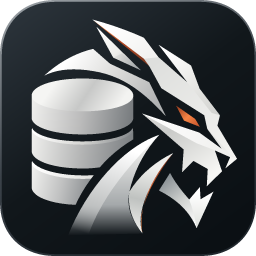
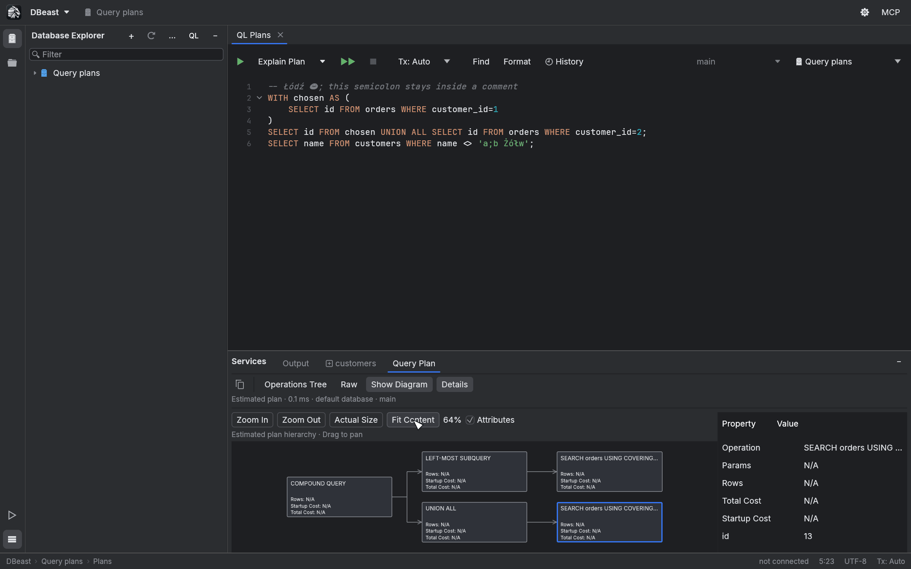
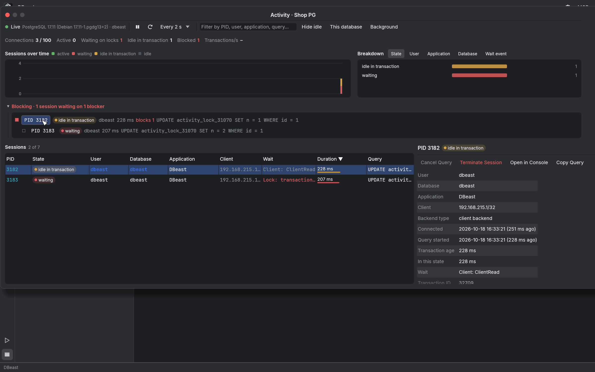
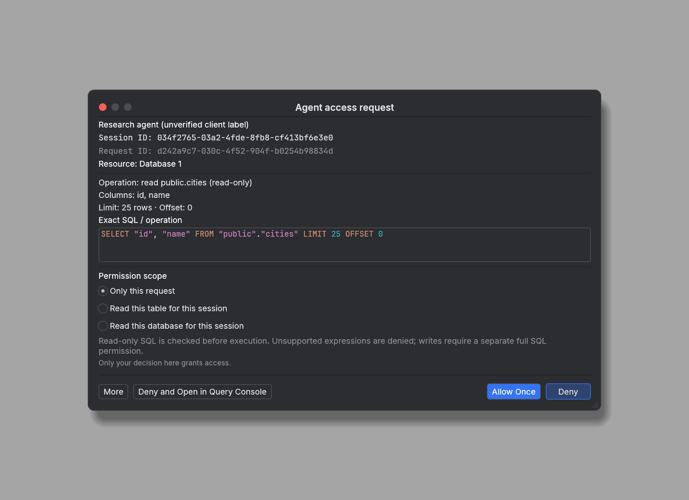

<div align="center">



# DBeast

### A fast, native database client for PostgreSQL, MySQL and SQLite

Written from scratch in Rust. Opens in a blink, stays light on memory and scrolls large
results smoothly, with the tools you expect from a professional database IDE.

[](https://github.com/macolszewski/dbeast_manager/actions/workflows/ci.yml)
[](./LICENSE)
[](./Cargo.toml)
[](#building-from-source)
[](https://macolszewski.github.io/dbeast_manager/guide/data-sources/)
[](https://macolszewski.github.io/dbeast_manager/guide/data-sources/)
[](https://macolszewski.github.io/dbeast_manager/guide/files/)
[](https://macolszewski.github.io/dbeast_manager/guide/ai-agents/)

[Features](#features) ·
[Screenshots](#screenshots) ·
[Building from source](#building-from-source) ·
[AI agents](#ai-agents-and-mcp) ·
[Documentation](https://macolszewski.github.io/dbeast_manager/) ·
[Contributing](#contributing)

<br>


</div>

## Why DBeast

Database IDEs built on a virtual machine pay for it every day: a slow start, gigabytes of
memory and stutter on large result sets. DBeast is a native application with a renderer that
draws only what is visible, drivers that talk the databases' own protocols and a UI thread
that never waits for the network.

- **Instant.** The first frame appears in about 0.1 s on a warm start, the idle window uses
  no CPU and the whole process stays around 100 MB.
- **Complete.** SQL console with completion and folding, an editable result grid, query
  plans, data import and export, schema graph, live activity monitor and more.
- **Safe with AI.** A built-in MCP server lets AI agents read the databases you share with
  them, with exact-SQL approval prompts and enforced read-only access.

## Features

<table>
<tr>
<td width="50%" valign="top">

#### Write and run SQL

- Console per tab with its own session, clause-aware **completion**, syntax highlighting,
  **code folding**, formatting, find and replace.
- Run the **statement under the caret** or the whole script; the statement that will run is
  outlined.
- Manual or automatic **transactions**, cancel at any time, query history and filter
  history.
- Per-console **default schema** for PostgreSQL and MySQL.

</td>
<td width="50%" valign="top">

#### Work with results

- Virtualized **result grid** with paging, sorting, **Transpose**, **Record View** and a
  JSON-aware value editor.
- **Edit** table data and simple console results, then Submit or Revert as one batch.
- **Find** in results, **local filters** per column, **aggregates** of the selection.
- **Related Rows** along foreign keys and **Compare Data** between fetched pages.

</td>
</tr>
<tr>
<td valign="top">

#### Understand the database

- Lazy **Database Explorer** with speed search, object counters, groups and DDL.
- **Explain Plan** and **Explain Analyse** for PostgreSQL and MySQL, as a tree, raw text or
  a diagram.
- **Database Graph**: tables, views and relations in 3D or 2D, sized by rows or storage.
- **DDL Diff** between two tables or views.

</td>
<td valign="top">

#### Move and watch data

- **Export** to CSV, TSV, JSON, SQL INSERT, Markdown, HTML and XML; **import** CSV and TSV
  into new or existing tables.
- **pg_dump**, **pg_restore** and **psql** with a guided dialog and a Run window for
  background tasks.
- **Activity Monitor** for PostgreSQL: live sessions, blocking chains, cancel and
  terminate.
- **Geo Viewer** for PostGIS and MySQL geometry, **Depth View** for time series.

</td>
</tr>
<tr>
<td valign="top">

#### Connect securely

- PostgreSQL, MySQL and SQLite with native Rust drivers; CSV, TSV, Data Package and SQLite
  files open as temporary sources.
- **SSH tunnel** (password, key or agent) written in Rust, **TLS** with CA, client
  certificates and host verification.
- Passwords in the **macOS Keychain**, the Linux **Secret Service** or encrypted with
  Windows **DPAPI**, never in plain text.

</td>
<td valign="top">

#### Work with AI agents

- Local **MCP server** on loopback with a separate token per agent connection.
- Share a whole source, one database or one table as catalog only, read-only or
  read-write.
- Every other request shows the **exact SQL** for approval; read-only access is enforced by
  an SQL policy, read-only transactions and locks.
- Bundled **agent skills** in [`.agents/skills`](.agents/skills).

</td>
</tr>
</table>

## Screenshots

<table>
<tr>
<td width="50%"><br><sub><b>Query plans</b> as an operations tree, raw output or a diagram.</sub></td>
<td width="50%"><br><sub><b>Database Graph</b> of tables, views and foreign keys.</sub></td>
</tr>
<tr>
<td><br><sub><b>Activity Monitor</b> with a blocking chain and session details.</sub></td>
<td><br><sub><b>AI agent request</b> waiting for approval, with the exact SQL.</sub></td>
</tr>
<tr>
<td><br><sub><b>Record View</b> next to the result grid.</sub></td>
<td><br><sub><b>Geo Viewer</b> for PostGIS and MySQL geometry.</sub></td>
</tr>
</table>

More in the [user guide](https://macolszewski.github.io/dbeast_manager/).

## Building from source

DBeast does not publish prebuilt binaries yet. You need a recent stable
[Rust toolchain](https://rustup.rs/).

### macOS

```bash
git clone https://github.com/macolszewski/dbeast_manager.git
cd dbeast_manager
./scripts/bundle-macos.sh          # builds target/release/DBeast.app
open target/release/DBeast.app
```

Move `DBeast.app` to Applications if you like. The bundle is signed ad hoc on your machine,
so macOS may ask again for Keychain access after you rebuild it. DBeast renders with Metal
and integrates its toolbar into the title bar.

### Linux

Install the build dependencies (Debian and Ubuntu package names), then build:

```bash
sudo apt install build-essential pkg-config libssl-dev libxkbcommon-dev libwayland-dev \
  libx11-dev libxcursor-dev libxrandr-dev libxi-dev libgl1-mesa-dev libegl1-mesa-dev \
  libgtk-3-dev libasound2-dev
cargo build --release
./target/release/dbeast
```

On Linux DBeast renders with OpenGL and uses the system title bar. Saved passwords go to the
Secret Service (GNOME Keyring, KWallet, KeePassXC); without one, choose *Until restart*.
Shortcuts use Ctrl in place of ⌘ and Alt in place of ⌥.

### Windows

DBeast runs on Windows 10 and 11 (x86-64). On Windows, install Rust from
[rustup.rs](https://rustup.rs/) with the Visual Studio Build Tools, then:

```powershell
cargo build --release
.\target\release\dbeast.exe
```

To build a Windows zip from macOS or Linux, install the mingw-w64 toolchain
(`brew install mingw-w64` or `apt install mingw-w64`) and run:

```bash
rustup target add x86_64-pc-windows-gnu
./scripts/build-windows.sh         # target/dist/DBeast-<version>-windows-x86_64.zip
```

The executable needs no extra DLLs. Saved passwords are encrypted with DPAPI for your Windows
account, and SSH agent authentication works with the OpenSSH Authentication Agent service or
Pageant. Shortcuts use Ctrl in place of ⌘ and Alt in place of ⌥.

### Configuration

| | macOS | Linux | Windows |
|---|---|---|---|
| Configuration | `~/Library/Application Support/dev.dbeast.dbeast/config.json` | `~/.config/dbeast/config.json` | `%APPDATA%\dbeast\dbeast\config\config.json` |
| Working session | `session.json` next to the configuration | same | same |

Set `DBEAST_CONFIG` to use another configuration file, for example a throwaway one while
testing. Neither file ever contains passwords; on macOS and Linux both are written with `0600`
permissions, on Windows they live in your user profile.

## Quick start

1. Open **Data Sources and Drivers** (the gear button or Find Action, `⌘⇧A`) and add a
   PostgreSQL, MySQL or SQLite source. **Test Connection** shows whether TLS was verified.
2. Expand the source in **Database Explorer**; objects load level by level.
3. Open a console (`⌘⇧L` or the **QL** button), type a query and press `⌘↵`.
4. Double-click a table to browse and edit its data; **Submit** writes your changes.

The [getting started guide](https://macolszewski.github.io/dbeast_manager/guide/getting-started/)
walks through the main window, and the
[keyboard shortcuts reference](https://macolszewski.github.io/dbeast_manager/reference/keyboard-shortcuts/)
lists every shortcut.

## AI agents and MCP

DBeast includes a local [Model Context Protocol](https://modelcontextprotocol.io/) server, so
assistants such as Claude Code or Codex can work with your databases without ever seeing a
password or a connection string.

1. Open **Settings > MCP Server**, pick a port and press **Start**. The server listens on
   `127.0.0.1` only.
2. Share what the agent may use: a source, a database or a table, as *Catalog Only*,
   *Read-Only Access* or *Read and Write Access*.
3. Choose **Create Agent Connection** and paste the generated configuration into the
   client. Each connection has its own token.

Read-only queries run through `query_sql`, which accepts only SQL that a full parser and the
database itself prove to be read-only. Anything else goes through `request_sql`, which waits
for you to approve the exact statement. Details: [AI agents guide](https://macolszewski.github.io/dbeast_manager/guide/ai-agents/)
and the [MCP contract](docs/design/mcp-contract.md).

## Performance

Measured on Apple Silicon with an empty configuration:

| Metric | Result |
|---|---|
| First frame, warm start | 75-125 ms |
| Resident memory, idle | about 100-107 MB |
| CPU, idle window | 0% |

The UI thread only draws: database, network and disk work runs on a Tokio runtime, the grid
and the explorer render only visible rows, and expensive results are cached and invalidated
explicitly. Methodology and per-feature measurements are in the
[performance reference](https://macolszewski.github.io/dbeast_manager/reference/performance/).

## Documentation

The documentation site at **<https://macolszewski.github.io/dbeast_manager/>** is built with MkDocs
from [`docs/`](docs):

- [User guide](https://macolszewski.github.io/dbeast_manager/guide/getting-started/): every feature,
  with screenshots.
- [Reference](https://macolszewski.github.io/dbeast_manager/reference/keyboard-shortcuts/): keyboard
  shortcuts, performance, testing and known limitations.
- [Design notes](https://macolszewski.github.io/dbeast_manager/design/): the MCP contract, credential
  storage, TLS and other technical decisions.

Preview it locally with `pip install -r docs/requirements.txt && mkdocs serve`.

## Roadmap

- Prebuilt, signed releases for macOS, Linux and Windows.
- More drivers and formats (DuckDB, Parquet).
- Schema comparison beyond a single object and entity relationship diagrams.
- Broader editing of console results and multi-record Related Rows.

The [known limitations](https://macolszewski.github.io/dbeast_manager/reference/limitations/) page
lists the current boundaries of each feature.

## Contributing

Contributions are welcome. Read [CONTRIBUTING.md](CONTRIBUTING.md) for the setup, tests and
conventions, and [AGENTS.md](AGENTS.md) for the architecture. Please report security issues
privately as described in [SECURITY.md](SECURITY.md).

```bash
./scripts/test-dbs.sh        # PostgreSQL, PostGIS, MySQL and SSH test containers
cargo clippy --all-targets
cargo test
```

## License

DBeast is created by [Maciej Olszewski](https://github.com/macolszewski) and released under
the [Apache License 2.0](LICENSE). Bundled fonts and third-party components are listed in
[NOTICE](NOTICE).

The dark color palette is taken from the dark theme of the
[IntelliJ Platform](https://github.com/JetBrains/intellij-community) (Apache License 2.0).
IntelliJ and JetBrains are trademarks of JetBrains s.r.o.; DBeast is an independent project,
not affiliated with or endorsed by JetBrains.
