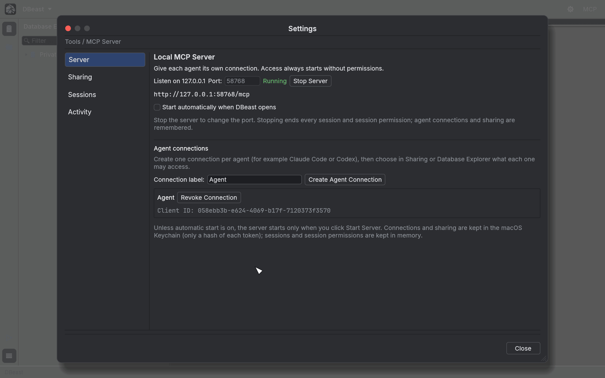
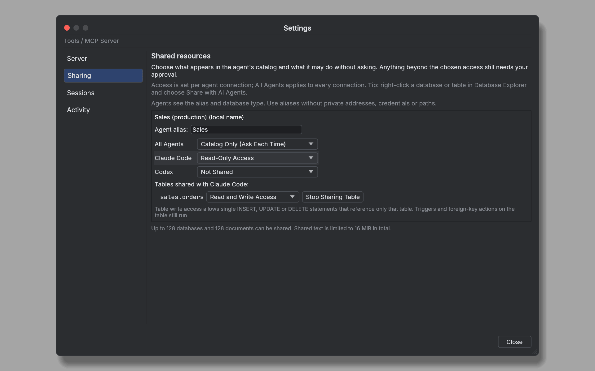
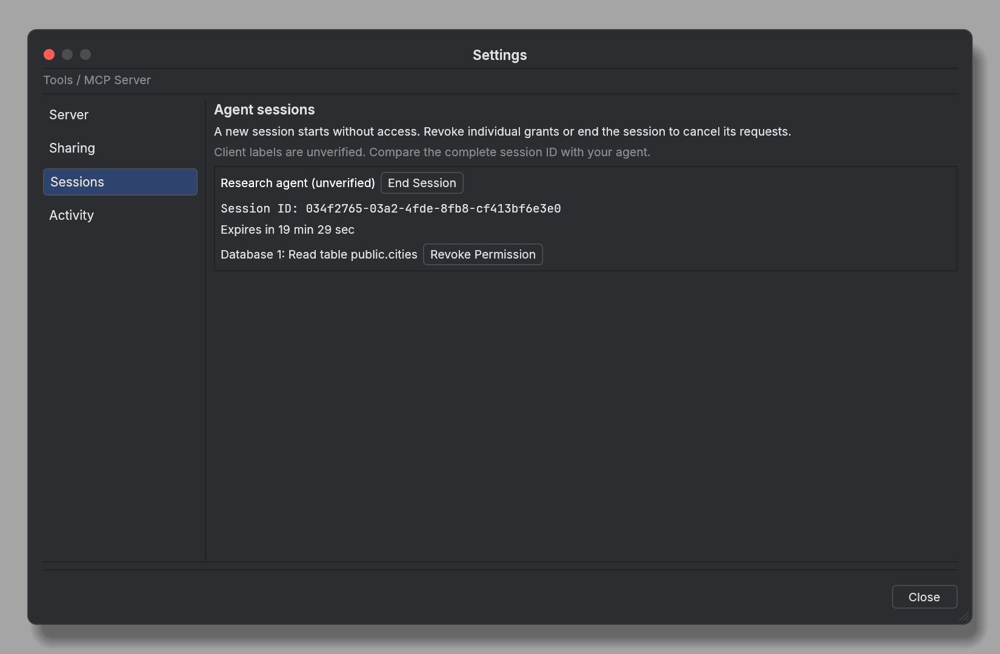
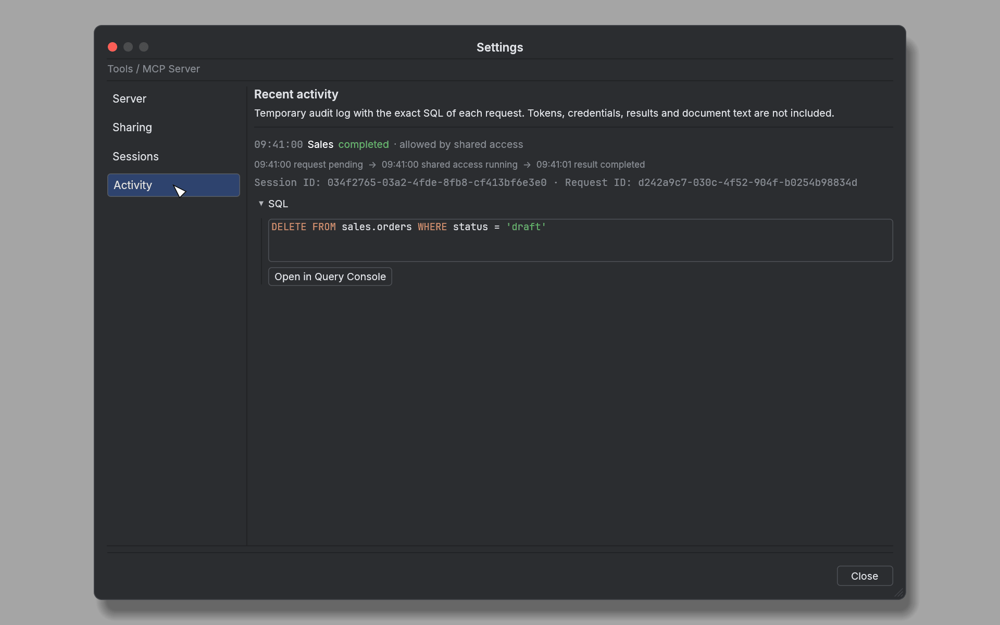

# AI agents (MCP server)

DBeast includes a local [Model Context Protocol](https://modelcontextprotocol.io) server. It lets AI agents such as Claude Code or Codex read the schema and data you explicitly share, ask for approval before anything else, and run queries on separate connections without touching your consoles. You stay in control: an agent starts every session with no permissions, and only your decision in DBeast grants access.

This page describes the feature from the user's side. The complete technical contract (tools, error codes, verification rules) is in the [MCP contract](../design/mcp-contract.md).

## Starting the server

Open the settings with the **MCP** button on the toolbar, or with **MCP Server** in Find Action (`⌘⇧A`, Ctrl+Shift+A on Linux). The **Settings** window has four sections: **Server**, **Sharing**, **Sessions** and **Activity**.

On the **Server** page:

1. Choose the **Port:**. The server listens only on `127.0.0.1` and shows its address, for example `http://127.0.0.1:57731/mcp`.
2. Click **Start Server**. The status changes to Running. **Stop Server** stops it; stop the server to change the port.
3. Optionally check **Start automatically when DBeast opens**.

The server uses the official `rmcp` SDK over Streamable HTTP and supports current and older MCP clients. Because it listens only on loopback, an agent that runs only in a remote cloud environment cannot reach `127.0.0.1` on your computer.



## Agent connections

Create one connection per agent, for example one for Claude Code and one for Codex:

1. Type a **Connection label:**.
2. Click **Create Agent Connection**. DBeast generates a token and a client configuration.
3. Copy the configuration into the agent's MCP settings, in the format the client supports. Do not store the token in a repository or paste it into a conversation.

Each connection has its own token. Connections and sharing settings are kept in the macOS Keychain (the system keyring on Linux), in a separate item next to the password vault. Only a SHA-256 hash of each token is stored, so the same token keeps working after a restart and after Stop Server. **Revoke Connection** invalidates it. Keeping these settings out of `config.json` means that an agent with file access cannot grant itself permissions. You can create a connection while the server is stopped.

## Sharing

An agent's catalog contains only what you share with its connection or with all connections. Data sources, imported files and open consoles must each be shared explicitly, under their own alias. The catalog never contains database addresses, passwords or file paths.

Share from either place:

- In the Database Explorer, right-click a data source, PostgreSQL database, MySQL database, table or view and choose **Share with AI Agents**, then pick a connection or **All Agents**.
- In **Settings ▸ MCP Server ▸ Sharing**, set the **Agent alias:** and the access level for **All Agents** and for each connection.

### Access levels

For a database or data source:

| Level | What the agent may do without asking |
|---|---|
| **Not Shared** | Nothing; the source is invisible to that connection |
| **Catalog Only (Ask Each Time)** | See the source in the catalog; every operation needs your approval |
| **Read-Only Access** | Verified read-only queries |
| **Read and Write Access** | Any SQL the connection's database account may run, without a prompt |

For a single table or view:

| Level | What the agent may do without asking |
|---|---|
| **Read-Only Access** | Verified reads of that table |
| **Read and Write Access** | Also single `INSERT`, `UPDATE` or `DELETE` statements that reference only that table and allowed built-in functions |

Triggers and foreign key actions defined on the table still run. Anything beyond the chosen level still triggers an approval prompt, and a data source marked **Read-only** never accepts writes. Open documents are shared with all connections. The agent's catalog reports the access level in the `shared_access` and `shared_tables` fields.

Lowering access takes effect at once. When you lower a database or table level, set a table to Not Shared or remove a connection's own entry (even if All Agents still has access), that connection loses the session permissions it was granted on the source, and its waiting, running and finished requests there are revoked, so their results are no longer handed to the agent. A write already sent keeps the status `outcome_unknown`. Raising access revokes nothing.

Up to 128 databases and 128 documents can be shared, with shared document text limited to 16 MiB in total.



## Approval prompts

When an agent asks for something its access level does not cover, DBeast shows an **Agent access request** dialog with:

- the client label (marked as unverified) and the public **Session ID**,
- the resource and the operation,
- the **exact SQL** that will run, with syntax highlighting, or the text snapshot of a document.

You can choose the permission scope (**Only this request**, **Read this table for this session**, **Read this database for this session**, or **Full SQL access for this session** for a Full SQL request) and then:

- **Allow Once** (with Only this request) or **Allow for Session** (with a session scope),
- **Deny**,
- **Deny and Open in Query Console**, which rejects the request and opens its SQL in a new console on the same data source and database, so you can fix and run it yourself.

Compare the session ID in the prompt with the one your agent reports. The session secret is a different value and is never shown. A pending request waits up to 5 minutes for your decision.


## Sessions

Every new conversation must call `begin_session`, because MCP does not tell the application where one conversation ends and the next begins. Each session gets a new public ID and a separate secret, and starts with no permissions. Calling `begin_session` again replaces the previous session of the same client, so parallel conversations need separate agent connections.

The **Sessions** page lists active sessions with their expiry time and the permissions granted to them. **Revoke Permission** removes a single grant, and **End Session** ends the session and cancels its requests. A session expires after 20 minutes of inactivity and after 2 hours at most.

Stopping the server invalidates all clients, sessions and results. Session permissions and tokens are never written to disk.



## Activity

The **Activity** page is a temporary audit log of the last 100 requests. It shows the exact SQL of each request, its status and how it was allowed (for example "allowed by shared access"). Tokens, credentials, results and document text are not recorded. **Open in Query Console** opens a request's SQL in a new console.



## query_sql and request_sql

Agents have two ways to run SQL:

- **`query_sql`** runs verified read-only SQL on the data source's configured account, including joins, CTEs, subqueries and supported aggregates. A full SQL parser, verification of every physical table and a read-only transaction reject writes, unverified functions, views, types and other unsupported constructs. A table grant covers only queries against that table.
- **`request_sql`** requires the Full SQL permission. It can use everything the connection's account is allowed to do, including objects outside the selected database. A **Read-only** data source blocks Full SQL.

A denied `query_sql` never upgrades to Full SQL automatically.

### Read-only guarantees

The read-only check verifies the whole table, up to 64 columns.

- **PostgreSQL** requires a primary server and the privilege to take a lock that stabilizes metadata during the read. It reads tables, materialized views and views. A view is accepted only if it uses built-in functions without side effects and every table beneath it passes the same check. CHECK constraints, expression and partial indexes, GIN indexes and `uuid`, `jsonb` and array columns are accepted as long as they use only built-in functions and types; typical Django tables pass. PostGIS columns and other extension types, enums, domains, row-level security, and indexes or CHECK constraints with user-defined functions are rejected.
- **MySQL** requires InnoDB and existing `LOCK TABLES` and `PROCESS` privileges.

A refusal gives a specific, safe reason in the response and in Activity. DBeast never changes the roles or privileges of the database user.

### Execution and limits

- Every operation runs on its own connection with time and size limits. Open console transactions stay independent, and agent requests never share a transaction with each other or with a console.
- Results contain at most 500 rows and 256 KiB of data. Larger results are marked as truncated.
- Reading a document returns only an approved snapshot of an open editor. Agents cannot open files by path.
- Cancelling does not undo a write that has already been committed, and an uncertain result is never retried automatically.

## Agent skills

The repository ships three portable skills in [`.agents/skills`](https://github.com/macolszewski/dbeast_manager/tree/master/.agents/skills). They guide an agent through using the server for a specific task. The server enforces permissions; the skills only explain how to work within them and grant no database access.

| Task | Skill | Covers |
|---|---|---|
| Starting work, accessing resources, reading an open console | `dbeast-mcp-session` | Client connection, conversation session, catalog, waiting for approval, document snapshots, ending the session |
| Exploring structure and analyzing data | `dbeast-mcp-read` | Smallest necessary scope, metadata, samples, `query_sql`, aggregates, engine limitations, full precision of values |
| A requested data change or another deliberate Full SQL operation | `dbeast-mcp-full-sql` | Exact SQL, separate approval, idempotency, verifying effects, unknown write outcomes |

Each directory contains its own `SKILL.md` and one reference file loaded when needed, and can be used on its own. The instructions are in English, use the tool names directly and do not depend on the prefix an MCP client adds.

### Installing the skills

- Codex detects `.agents/skills` while working in this repository and its subdirectories.
- Outside the repository, copy whole skill folders to `~/.agents/skills`. Keep any existing versions so you can compare them deliberately.
- Other clients that support the Agent Skills format may need their own directory or an import step. The presence of the files does not mean every client loads them automatically.

The skills do not start the server, change the client configuration or contain tokens.

### Example tasks

After setting up the connection, you can ask, for example:

```text
Use $dbeast-mcp-session. Show the shared resources and summarize the open console.
Use $dbeast-mcp-read. For the "Sales" source, find the 10 customers with the highest order totals.
Use $dbeast-mcp-full-sql. In the "Test" source, change the status of order 42 from draft to ready and verify the result.
```

### How agents should behave

- Start a new DBeast session for every new conversation, choose a resource from the catalog, submit one immutable request and poll its status as advised by `poll_after_ms`.
- Every intent has its own `request_key` UUID. To recover a lost response, repeat the call with the same key and identical arguments in the same session. An unknown write outcome must not be treated as a rollback and retried with a new key.
- Check `truncated` in results, keep exact text values, and read documents by version and Unicode characters.
- Routine analysis uses the read skill and never needs the Full SQL instructions. The user's request defines the scope of work, and approval in DBeast allows a specific execution or session scope; the skills replace neither boundary.
