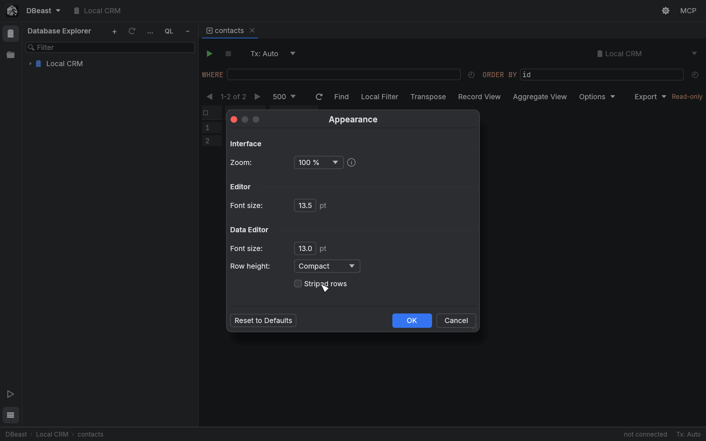
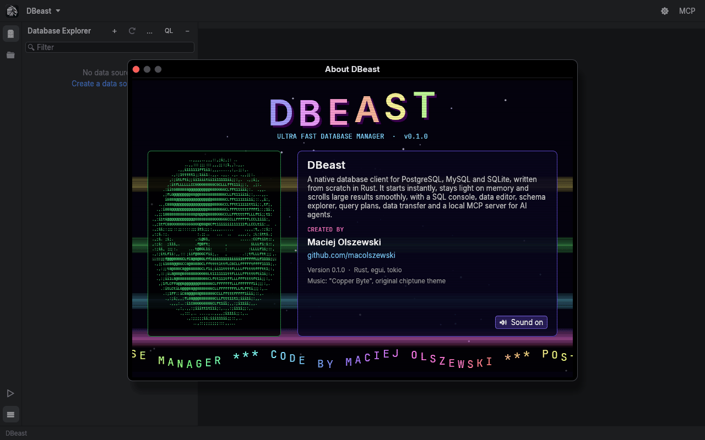

# Appearance

DBeast uses a dark theme with Inter as the interface font and JetBrains Mono in the editor (both under the SIL Open Font License). The interface and SQL syntax colors are taken from the dark theme of the [IntelliJ Platform](https://github.com/JetBrains/intellij-community), available under the Apache License 2.0; see [NOTICE](https://github.com/macolszewski/dbeast_manager/blob/master/NOTICE). You can scale the whole interface, change font sizes and adjust how dense the results grid looks. On Linux, `⌘` maps to Ctrl and `⌥` to Alt in the shortcuts on this page.

## Appearance dialog

Open **DBeast ▸ Appearance…** or search for Appearance in Find Action (`⌘⇧A`).

| Section | Setting | Values |
|---|---|---|
| Interface | **Zoom:** | 50% to 250% in 10% steps |
| Editor | **Font size:** | SQL editor font size in 0.5 pt steps |
| Data Editor | **Font size:** | Results grid font size in 0.5 pt steps; also used in Record View |
| Data Editor | **Row height:** | Compact, Default or Comfortable |
| Data Editor | **Striped rows** | Alternate row background |

Changes are applied immediately as a preview. **OK** saves them to `config.json`, **Cancel** restores the previous look, and **Reset to Defaults** returns every setting to its default value.

With striped rows enabled, the results grid, the transposed grid, Record View and property tables use an alternating row background, with separate shades for the dark editor background and for panels.

## Zoom IDE

Zoom IDE scales the entire interface in 10% steps, from 50% to 250%. The scale is saved in the configuration.

| Shortcut | Action |
|---|---|
| `⌃⌥⇧=` | **Zoom In IDE** |
| `⌃⌥⇧-` | **Zoom Out IDE** |
| `⌃⌥⇧0` | **Reset IDE Zoom** (100%) |

On Linux the shortcuts are Ctrl+Alt+Shift with the same keys. The commands are also in **DBeast ▸ Zoom IDE** and in Find Action. The shortcuts match the physical key, so they work regardless of the keyboard layout.

`⌘=` and `⌘-` are not zoom shortcuts: in the SQL editor they unfold and fold code.

## Integrated title bar on macOS

On macOS, the main toolbar replaces the system title bar. The close, minimize and zoom buttons sit at its left end.

- Drag an empty area of the toolbar to move the window, and double-click it to maximize.
- In full screen, the space reserved for the window buttons disappears.
- The window buttons are drawn by the system and do not scale with Zoom IDE, so the toolbar keeps the same on-screen height and space for them at every zoom level.

On macOS DBeast renders through wgpu with Metal, and only the Metal backend is compiled in. The application requests the integrated GPU and keeps a single frame in the queue, so on Macs with two graphics cards it does not wake the discrete GPU. Linux uses OpenGL and the system title bar.

Dialogs inside the application (Data Sources and Drivers, MCP settings, approval prompts, DDL Diff, Related Rows, closing tabs, data source groups) are modal, have a title bar and can be moved and, except for short confirmations, resized. They open centered. Escape or the close button closes them; clicking outside does not. On macOS their title bar has a red close button on the left (minimize and zoom are gray, because these windows do not have them) and a centered title. On Linux the close button is a × on the right.

## Startup screen

DBeast has its own application icon and a startup screen with the tagline "Ultra Fast Database Manager". While the configuration and passwords load (including while macOS asks for keychain access), the splash shows progress. After an error it shows the message and a **Retry** button.

The splash stays visible for at least 0.8 s after the first frame. Press any key or click to skip it; that input is not passed to the editor. Once the workspace opens, the logo remains as the background of the empty editor area, together with a list of the most important shortcuts.

## About DBeast

Open **DBeast ▸ About DBeast**, or find it in Find Action.

The About screen is a 90s-style cracktro: a starfield, copper bars, a waving logo, an ASCII portrait of the author and a scrolling text. DBeast is created by **Maciej Olszewski** ([github.com/macolszewski](https://github.com/macolszewski)).

The theme music, "Copper Byte", is an original looping chiptune built into the program (Ogg Vorbis, 51.2 s, 864 KB).

- Music starts by default when the screen opens.
- The **Sound on** / **Sound off** button mutes or unmutes it. Your choice is saved in the configuration and applies the next time you open the screen.
- Animation and playback run only while the window is open. Audio is decoded on a separate thread, and closing the window releases the audio device, so an idle DBeast still uses no CPU.
- On Linux, playback uses ALSA.

