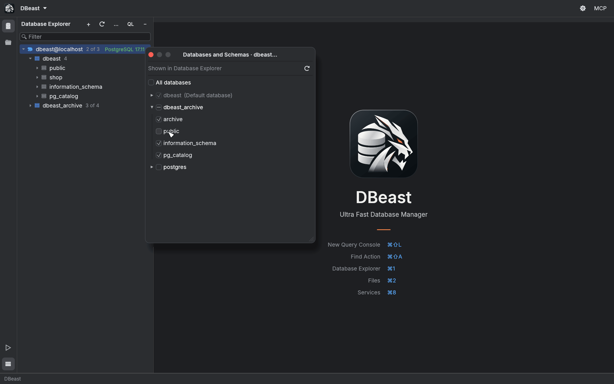
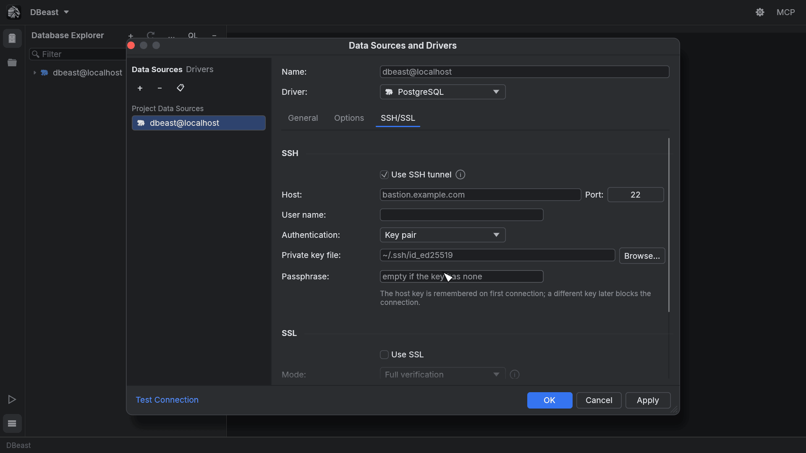
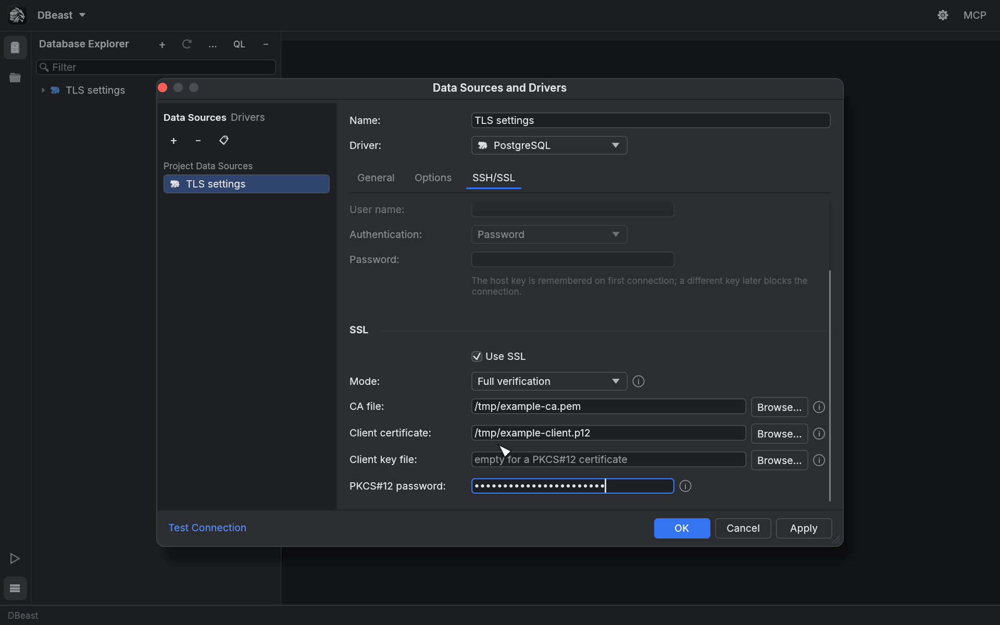
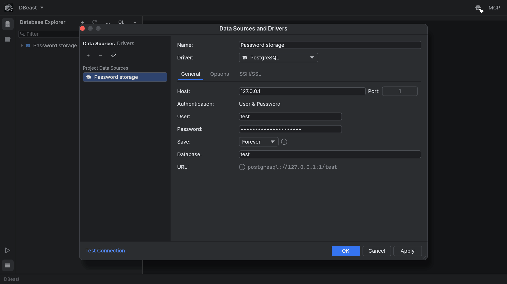
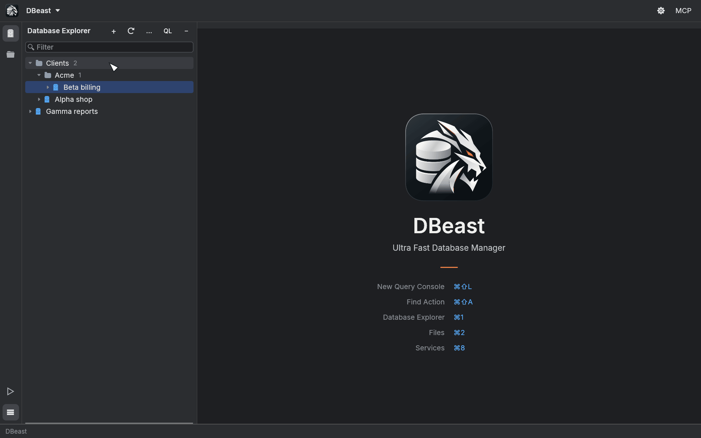
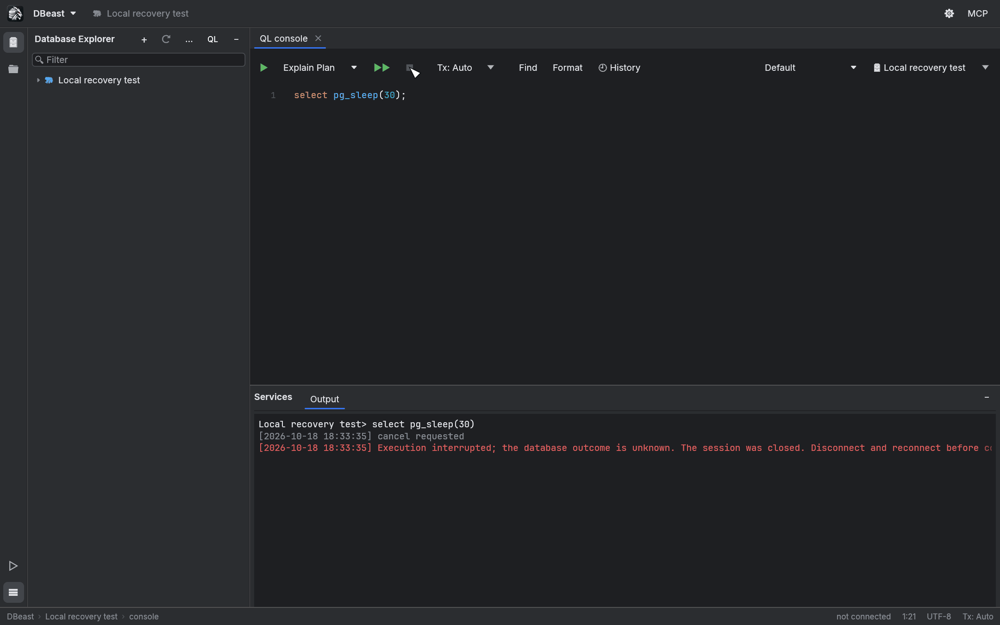

# Data sources

A data source is a saved connection to a database server or a database file. This page covers creating and editing data sources, the supported drivers, secure connections, password storage and how DBeast behaves when a connection breaks.

Shortcuts use macOS symbols; on Linux and Windows, ⌘ is Ctrl.

## The Data Sources and Drivers dialog

Open the dialog in any of these ways:

- click the gear button on the main toolbar;
- choose **Data Sources and Drivers** in the DBeast menu or in Find Action (`⌘⇧A`);
- choose **Data Source Properties…** in the Database Explorer **…** menu;
- click **Create a data source…** in an empty Database Explorer.

The left side lists **Project Data Sources**. Drag the edge of the list to make it wider. The buttons above the list:

| Button | Action |
|---|---|
| **+** | Add a data source; choose PostgreSQL, MySQL or SQLite. |
| **−** | Remove the selected data source. |
| Duplicate | Copy the selected data source. The copy is named `<name> (copy)` and gets its own saved passwords. |

The right side edits the selected source: **Name**, **Driver** and three tabs, **General**, **Options** and **SSH/SSL**.

The footer holds **Test Connection** and the **OK**, **Cancel** and **Apply** buttons:

- **Test Connection** checks the current form without saving it. The result appears next to the link: `Succeeded` with the server version and connection security, or the first line of the error (hover over it for the full message). Changing the form discards the old result. The test times out after 15 s.
- **Apply** and **OK** save your changes. Passwords and the configuration are written in the background, and the dialog confirms only after the save has finished.
- **Cancel** discards the draft.

Escape or the close button also closes the dialog. Clicking outside it does not.

## Supported drivers

All drivers are built into DBeast as native libraries; no JDBC driver or Java runtime is involved.

| Database | Notes |
|---|---|
| PostgreSQL | Binary protocol. Values without an exact typed form (numeric beyond 28 digits, arrays, intervals, ranges, composite, network and geometric types) are shown exactly as PostgreSQL prints them. A type DBeast cannot read exactly, such as `money` or `tsvector`, is shown as `<type: hex>` and stops an export. Cancels queries with a cancel request. |
| MySQL | Distinguishes TEXT from BLOB by character set. Cancels queries with `KILL QUERY` from a second connection. |
| SQLite | Embedded SQLite engine; opens a local file. Cancels queries with an interrupt. |

In addition, you can open CSV and TSV files, Data Packages and SQLite files as temporary data sources without adding them to the configuration. See [Files](files.md).

### General tab

For PostgreSQL and MySQL:

| Field | Description |
|---|---|
| Host, Port | Server address. Changing the driver resets the port to the driver default. |
| Authentication | User & Password. |
| User, Password | Database credentials. |
| Save | Where the password is kept: **Forever** or **Until restart** (see [Password storage](#password-storage)). |
| Database | Default database to connect to. |
| URL | Read-only connection URL built from the fields above. |

For SQLite, the General tab has a single **File** field with **Browse…**. The file picker accepts `.sqlite`, `.sqlite3`, `.db`, `.db3` and `.gpkg` files.

## Several databases under one data source

A single PostgreSQL or MySQL data source can show more than one database:

- PostgreSQL lists the server databases your account may `CONNECT` to.
- MySQL lists its schemas.

To choose what appears in the Database Explorer, click the counter next to the data source (for example `12` or `1 of 3`), or choose **Databases and Schemas…** in its context menu.

- **All databases** shows every database.
- Select individual databases; the default database is always shown.
- Expand a database to pick its schemas. A database with some schemas hidden shows a partially checked box, and the tree shows an `N of M` counter next to it.

Each PostgreSQL database uses its own connection. Tables, DDL and consoles opened from a database's context menu work in that database, and the console toolbar has a database selector next to the data source selector. The selection is saved with the data source.

## SSH tunnel

Use an SSH tunnel when the database is reachable only from an internal network. Open the **SSH/SSL** tab and select **Use SSH tunnel**.

| Field | Description |
|---|---|
| Host, Port | The SSH server (bastion). |
| User name | SSH user. |
| Authentication | **Password**, **Key pair** or **OpenSSH agent**. |
| Private key file | For Key pair; choose it with **Browse…**. |
| Passphrase | For an encrypted private key; leave empty if the key has none. |

How the tunnel works:

- The database host and port from the **General** tab are resolved on the SSH server side, so you can use internal host names.
- All sessions of a data source (the Database Explorer and every console) share one tunnel, which closes together with the last session.
- The SSH host key is remembered on the first connection in a `known_hosts` file stored next to the DBeast configuration, not in `~/.ssh`. If the host key changes later, the connection is blocked.
- SSL to the database also works through the tunnel, and certificates are verified against the real database host name.

The tunnel is implemented inside DBeast; no external `ssh` program is run.

## SSL/TLS

To encrypt the connection to PostgreSQL or MySQL, select **Use SSL** in the SSL section of the **SSH/SSL** tab. For SQLite this tab only explains that a local file has no network connection to secure.

### Modes

| Mode | What is checked |
|---|---|
| **Require** | The connection is encrypted, but the server certificate is not checked. Use only on trusted networks. |
| **Verify CA** | The server certificate must be signed by a trusted CA. The host name is not checked. |
| **Full verification** (default) | The certificate must be signed by a trusted CA and issued for the host name, also through SSH. |

When SSL is enabled, PostgreSQL and MySQL connections never fall back to an unencrypted connection if the server does not support TLS.

### Certificates

| Field | Accepted formats |
|---|---|
| CA file | PEM or DER CA certificates, in addition to the system's trusted roots. |
| Client certificate | A PEM certificate (or chain) together with a key file, or a PKCS#12 archive (`.p12`, `.pfx`) that contains both. |
| Client key file | Unencrypted PEM private key: PKCS#8, PKCS#1 RSA or SEC1 EC. Leave empty for a PKCS#12 certificate. |
| PKCS#12 password | Password of the PKCS#12 archive. |

Every path has a **Browse…** button. Encrypted PEM keys are not supported; convert the certificate and key to PKCS#12 instead.

### What Test Connection reports

Test Connection and the server description show exactly what was verified:

| Label | Meaning |
|---|---|
| `TLS (verified)` | Encrypted, certificate and host name verified. |
| `TLS (CA verified, host name not checked)` | Encrypted, certificate chain verified. |
| `TLS (certificate not verified)` | Encrypted only. |
| `Unencrypted` | No TLS. |
| `Local file` | SQLite file. |

## Password storage

DBeast never writes passwords to `config.json`. The database password, SSH password, SSH key passphrase and TLS identity password of a data source are stored together, in one protected record per configuration file:

- on macOS, in the Keychain;
- on Linux, in the system credential store through Secret Service (GNOME Keyring, KWallet, KeePassXC and others) on the session D-Bus. The desktop may ask you to unlock it;
- on Windows, in a file under the configuration folder (`credentials\`), encrypted with DPAPI for your Windows account, so another account or another computer cannot decrypt it. Credential Manager is not used because it limits one secret to 2.5 KB.

The **Save** option applies to all four secrets of the data source:

| Save | Behavior |
|---|---|
| **Forever** | Passwords are kept in the credential store between launches. |
| **Until restart** | Passwords are kept only in application memory and are forgotten when DBeast quits. |

Things to know:

- At startup, DBeast reads the credential record once, regardless of the number of data sources.
- On Linux without a Secret Service provider, saving with **Forever** fails with a message; choose **Until restart** instead.
- If access to the credential store is denied, DBeast never falls back to storing passwords in plain text. The dialog offers **Retry password loading** and **Replace unavailable passwords**. The second option replaces all four passwords of the source, including with empty values. A data source with unavailable passwords does not connect, also from a restored console.
- If saving fails, **Reload settings and discard changes** reloads the saved settings. Your unsaved changes are kept unless the reload succeeds. Changed or removed data sources are disconnected and not reconnected automatically.
- When you close the window, DBeast waits for a pending configuration save to finish. **Exit without waiting** closes the application without that guarantee.

!!! note
    The credential record is tied to the location of the configuration file. A copy of `config.json` in another location cannot read or delete the passwords of the original. If you move the file, move it back to its original path, or re-enter the passwords for the new copy.

## Read-only data sources

On the **Options** tab, select **Read-only** under **Access** to protect a database from accidental changes. Sessions then open in read-only transaction mode and the server rejects writes. AI agents connected through the MCP server never get write access to a read-only source either.

## Data source groups

Groups are folders in the Database Explorer that help organize many data sources.

- Create a group with **+** > **Data Source Group…** in the Database Explorer, or **New Group…** in a group's context menu.
- Use `/` in the name to nest groups, for example `Clients/Acme`.
- **Move to Group** in a data source's context menu moves it into a group or back to the top level.
- Drag data sources to reorder them. Dropping above or below another source places it next to that source (and in its group); dropping onto a group adds it at the end of the group.
- **Rename Group…** renames a group. **Remove Group** moves its contents to the parent group; nothing is deleted.

Groups and the order of sources are saved as the explorer layout, separately from the connection settings. Changing them does not disconnect a data source or change its identity for AI agents. Speed Search finds groups too.

## Connection recovery and keepalive

DBeast detects broken connections instead of waiting indefinitely:

- **Connection timeout.** Opening a connection, including authentication, times out after 15 s.
- **PostgreSQL keepalive.** TCP keepalive probes start after 30 s of inactivity and repeat every 10 s, three times. On Linux, unacknowledged data also times out after 60 s.
- **Waiting for a connection.** Stop, Disconnect and closing the tab also cancel a console that is still waiting for its connection.

### Stopping a running statement

When you press **Stop** (`⌘F2`) during execution, DBeast sends a cancel request and waits at most 1 s for it to be sent. It then closes the console session and unlocks the console, even if the server does not respond.

This is a deliberate trade-off in favor of data safety:

- The outcome of the interrupted statement may be unknown. DBeast does not retry it automatically.
- An open manual transaction is not preserved.
- Before continuing, **Disconnect** the data source (Database Explorer **…** menu or the data source context menu) and connect again.
- If you interrupted a write, check its result in the database before trying again.
