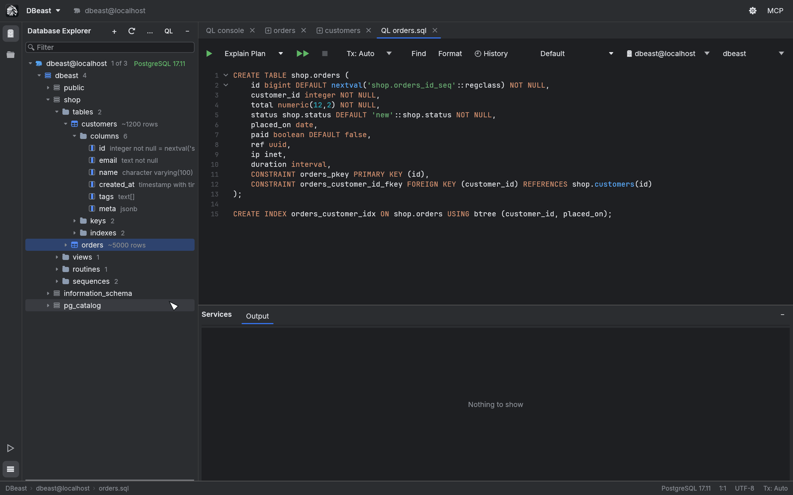
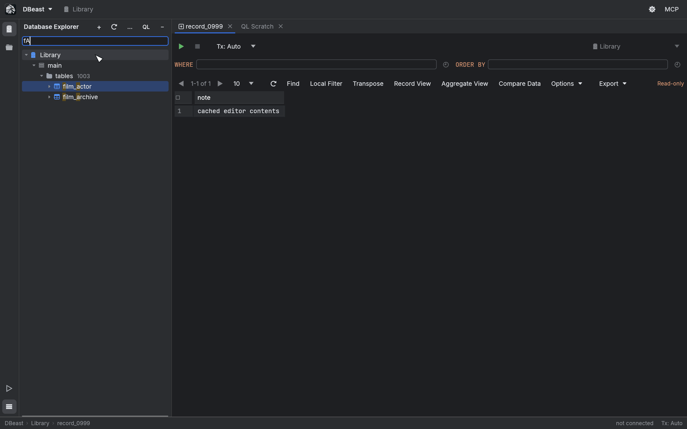
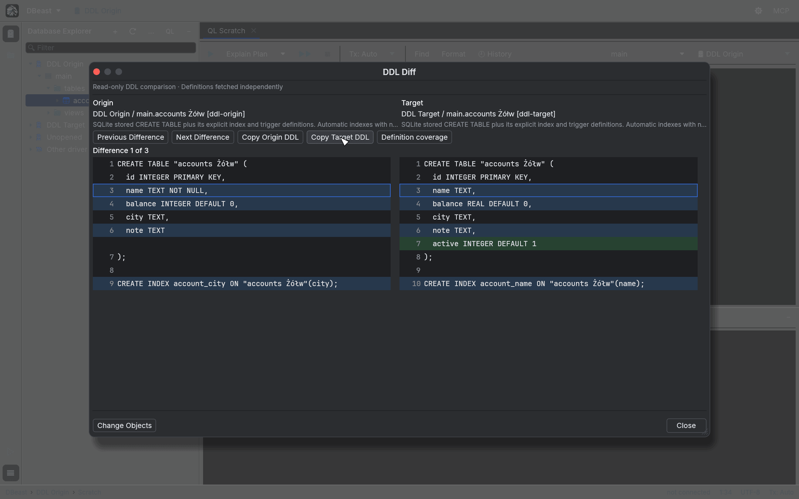

# Database Explorer

The Database Explorer is the tree on the left side of the window. It shows every data source, the databases and schemas inside it, and the objects in each schema. Open it with `⌘1`. On Linux, `⌘` maps to Ctrl and `⌥` to Alt in every shortcut on this page.

## The tree

The tree follows this structure:

- data source
    - database
        - schema
            - **tables**, **views**, **routines**, **sequences**
                - table
                    - **columns**, **keys**, **indexes**

Folders show the number of objects they contain as gray text, and tables show their estimated row count (for example `~1200 rows`). Columns show their type and constraints next to the name.

### Lazy loading

Nothing is read from the database until you need it. Each level is fetched in the background the first time you expand it, so a server with thousands of tables opens as quickly as a small one. Expanding a node that has not been loaded opens the connection if it is not open yet.

Only the visible rows of the tree are drawn. The hierarchy index is rebuilt only when the data, the expanded nodes, the scope or the search pattern changes, so moving the selection does not rebuild it.

### Keyboard navigation

| Key | Action |
|---|---|
| `↑` / `↓` | Select the previous or next node |
| `←` / `→` | Collapse or expand the selected node |
| `Home` / `End` | Jump to the first or last node |
| `Page Up` / `Page Down` | Move by one visible page |
| `Enter` / `F4` | Open the selected table or view |
| `⌘F` or start typing | Speed Search |
| `Escape` | Clear Speed Search; with an empty field, return to the editor |
| `⇧Escape` | Hide the Explorer and return to the editor |

## Speed Search

Start typing while the tree has focus, or press `⌘F`, to search the tree.

- Matching ignores case and accepts abbreviations: the characters you type must appear in the name in the same order, but not next to each other. `fA` matches `film_actor` and `film_archive`.
- The search covers only nodes that are expanded and already loaded, within the databases and schemas selected for the source. It never opens a connection or fetches more data.
- `↑` and `↓` in the search field move between matches and wrap around.
- By default the tree is filtered to the matches. Turn off **Speed Search Filter** in the Explorer menu to highlight matches without hiding other nodes.
- Speed Search also finds data source groups.

Unicode names are compared in lowercase, without normalization or full case folding.

## Databases and schemas shown

A single data source can contain several databases:

- **PostgreSQL** lists the server databases your account has the `CONNECT` privilege on.
- **MySQL** lists its schemas (databases).

The counter next to the data source, such as `12` or `1 of 3`, tells you how many databases are shown. Click the counter, or choose **Databases and Schemas…** from the context menu, to open the scope chooser:

- **All databases** shows every database the account can see.
- Select individual databases. The default database is always shown.
- Expand a database to choose its schemas. A database with some schemas hidden has a partially checked box, and the tree shows a counter such as `3 of 4` next to it.

The selection is saved in the data source configuration.

Each PostgreSQL database has its own connection. Tables, DDL and consoles opened from a database's context menu work in that database, and a console opened there shows a database selector next to the data source selector.

## Context menu

Right-click a node to see the actions available for it. Depending on the node type, the menu includes:

| Action | Available on | Result |
|---|---|---|
| **New ▶ Query Console** | data source, database | Opens a console connected to that source and database |
| **Edit Data** | table, view | Opens the table editor with the data |
| **Generate DDL to Query Console** | table, view and other objects | Opens the object definition in a new console |
| **Compare Structure With** | table, view | Opens DDL Diff against another object (see below) |
| **Copy Name** | objects | Copies the object name |
| **Refresh** | any node | Reloads that part of the tree |
| **Disconnect** | data source | Closes the source's connections |
| **Databases and Schemas…** | data source | Opens the scope chooser |
| **Data Source Properties…** | data source | Opens the data source settings |
| **Move to Group** | data source | Moves the source into a group or to the top level |
| **Import/Export** | table, schema, database, data source | Export, import and PostgreSQL dump tools, see [Import and export](import-export.md) |
| **Activity Monitor** | PostgreSQL data source or database | Opens the [Activity Monitor](activity-monitor.md) |
| **Show Database Graph** | data source, database, schema | Opens the [Database Graph](visualization.md#database-graph) |
| **Share with AI Agents** | data source, database, table, view | Shares the object with the local MCP server, see [AI agents](ai-agents.md) |

Double-clicking a table also opens it in the table editor. See [Results grid](results-grid.md) for editing data.

## Data source groups

Groups are folders that organize data sources in the tree.

- Create a group with **New › Data Source Group…**, or with **New Group…** in a group's menu.
- A `/` in the name creates nested groups, for example `Clients/Acme`.
- **Move to Group** in a data source menu moves the source into a group or back to the top level.
- Drag a data source to reorder it. Dropping above or below another source places it there (and moves it into that source's group); dropping onto a group adds it at the end of the group.
- **Rename Group…** renames a group. **Remove Group** moves its contents to the parent group and deletes nothing.

Groups and ordering are saved in the configuration as the Explorer layout, separately from connection settings. Changing them does not disconnect a source or change its identifier in the MCP server. See also [Data sources](data-sources.md).

## DDL view

**Generate DDL to Query Console** opens the definition of the selected object in a new console, with syntax highlighting and code folding. You can edit and run the generated SQL like any other console content.

## Compare Structure With and DDL Diff

**Compare Structure With** in the menu of a table or view lets you choose a second object of the same kind and driver that is already loaded in the tree. DDL Diff then fetches both definitions on separate connections and shows them side by side.

The DDL Diff window provides:

- line numbers and synchronized scrolling of both sides,
- **Previous Difference** and **Next Difference** (`⇧F7` / `F7`),
- **Copy Origin DDL** and **Copy Target DDL**, which copy the full definition,
- **Definition coverage**, which describes what the driver includes in the definition,
- **Change Objects** to pick other objects.

The data source, database and schema of each side are shown explicitly. Changing the configuration while definitions are being fetched invalidates the result.

### What is compared

The comparison covers the exact text of the fetched DDL, including names, whitespace and line endings. Identical text is reported as "No differences in fetched DDL". This is not a confirmation that the entire structure is identical. Migrations, whole-schema comparison and applying changes are not part of this feature.

Coverage depends on the driver:

- **PostgreSQL** reconstructs selected table properties and view definitions. It does not cover, among other things, full identity and generated column semantics, privileges, triggers and row-level security. Partitioned, inherited, foreign and temporary tables are excluded.
- **MySQL** uses `SHOW CREATE`, keeping `AUTO_INCREMENT` and `DEFINER`.
- **SQLite** covers the persistent `main` file: the stored `CREATE` statement plus explicit indexes and triggers of tables. View triggers are out of scope. `ATTACH` and in-memory databases are not supported.

### Limits

- Each side is read as an independent snapshot. PostgreSQL uses a short read-only transaction per side. Your console and its transaction are not affected.
- Fetching has a 15 s timeout, can be cancelled and uses a bounded queue.
- A definition may be up to 8 MiB and 100,000 lines per object.
- Aligning large blocks of changes has a limited time budget. When the budget is exceeded, the window says that the alignment was simplified; the full text stays available.
- Lines longer than 4096 bytes are shortened in the preview. Copy DDL always copies the full definition.

## Scroll from Editor and Collapse All

Both commands are in the Explorer menu and in Find Action (`⌘⇧A`).

- **Scroll from Editor** reveals the object of the active tab in the tree. It loads only the missing ancestors and respects the selected schemas. Switching tabs, navigating manually or a loading error cancels a pending reveal, and late data never takes focus. For a console, it selects the console's data source; locating the object under the SQL cursor is not supported yet.
- **Collapse All** collapses the whole tree.
