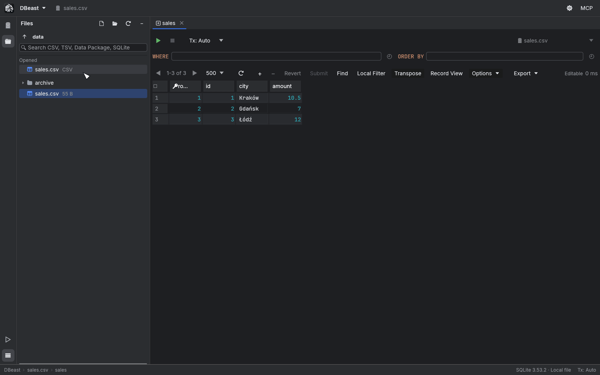
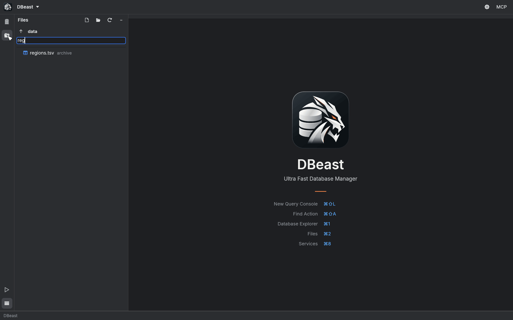

# Files

DBeast can open data files directly, without adding a permanent data source. An opened file becomes a temporary data source: you browse it in the grid, query it in a SQL console, filter, transpose and export it like any database table.

Shortcuts use macOS symbols; on Linux, ⌘ is Ctrl.

## Supported files

| Format | Details |
|---|---|
| CSV and TSV | The separator is detected automatically: `,`, `;`, tab or `|`. |
| Data Package | A `datapackage.json` file with local CSV resources. Each resource becomes a separate table. |
| SQLite | Files with the `.sqlite`, `.sqlite3`, `.db` or `.db3` extension. |

## Open a file

Use any of these:

- double-click the file in the **Files** tool window;
- click the Open File… button in the Files tool window header;
- choose **Open File…** in the DBeast menu.

The file opens as a temporary data source. For a CSV or TSV file, its table opens in a new tab right away; for a Data Package, the first table opens. A SQLite file opens a new query console. Opening a file that is already open switches to its tab. A temporary source is not written to your configuration and disappears when you close the file.

To close a file, right-click it in the **Opened** section of the Files tool window (or the source in the Database Explorer) and choose **Close File**. If the file has unsaved changes or a running operation, DBeast warns you first, the same way as when closing tabs.

## The Files tool window

Press `⌘2`, or click the folder icon on the tool window bar, to show the Files tool window. It shares the left panel with the Database Explorer.

- The header buttons are **Open File…**, **Open Folder…** (choose the folder to browse), **Refresh** and **−** (Hide).
- The ↑ button goes to the parent folder; the current folder name is shown next to it.
- The **Opened** section lists files that are currently open as data sources. Click one to switch to it.
- The tree below shows the current folder and lists only supported files.

Type in the search field (**Search CSV, TSV, Data Package, SQLite**) to find files by name in the folder and its subfolders. The search runs in the background and skips hidden folders, `node_modules` and `target`.

## Working with CSV and TSV files

A CSV or TSV file is loaded into a temporary SQLite database. As a result, every grid and console feature works on it: sorting, Find, local filters, Transpose, Record View, SQL queries and export.

You can also edit the data. Changes you commit, either with **Submit** in the grid or with `UPDATE`, `INSERT` or `DELETE` in a console, are written back to the file:

- the original separator and row order are kept;
- unchanged cells are written exactly as they were.

Column types are inferred conservatively. A column becomes numeric only when every value converts back to exactly the same text, so values such as `007` or `1.50` stay text and are never altered.

Each row is identified by the hidden SQLite `rowid`, which appears as an extra read-only column in the grid. See [Editing data](results-grid.md#editing-data).

## Working with SQLite files

A SQLite file is opened directly, without copying. Everything you can do with a configured SQLite data source works the same way. To keep a SQLite database in your project permanently, add it as a data source instead (see [Data sources](data-sources.md)).

## Related topics

- [Import and export](import-export.md): import CSV files into a database table, or export results to files.
- [Results grid](results-grid.md): browsing and editing data.
