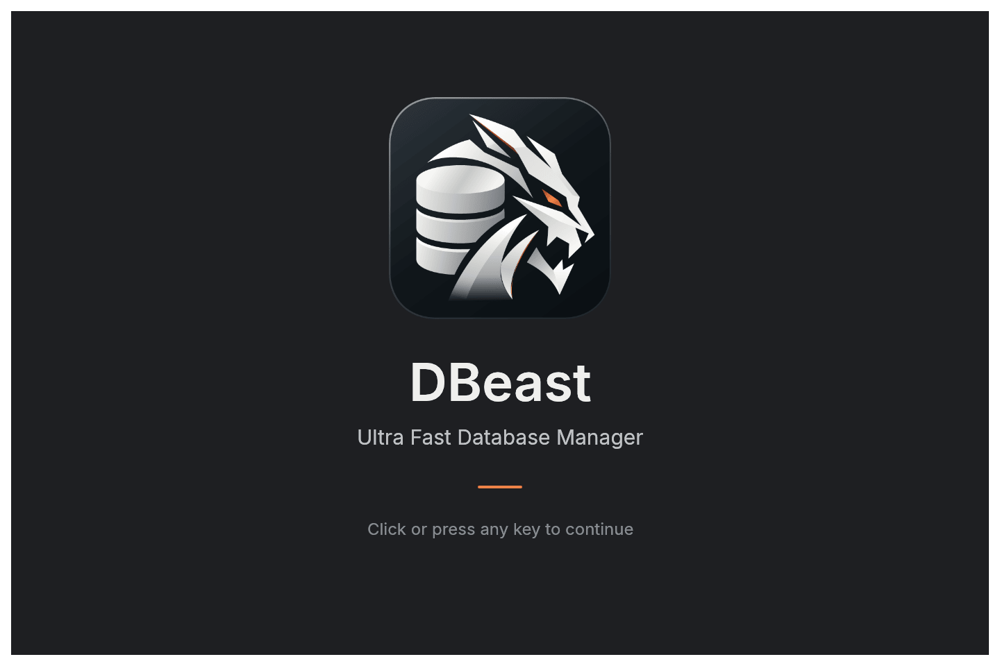
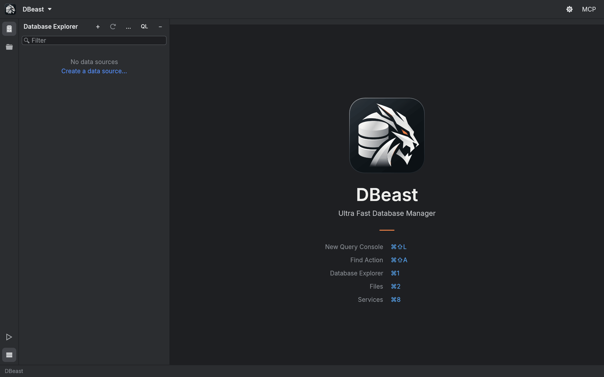
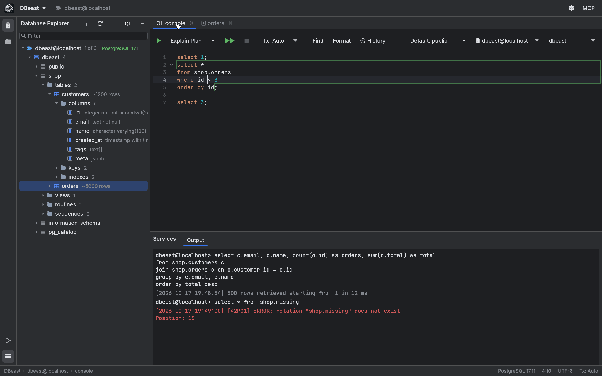
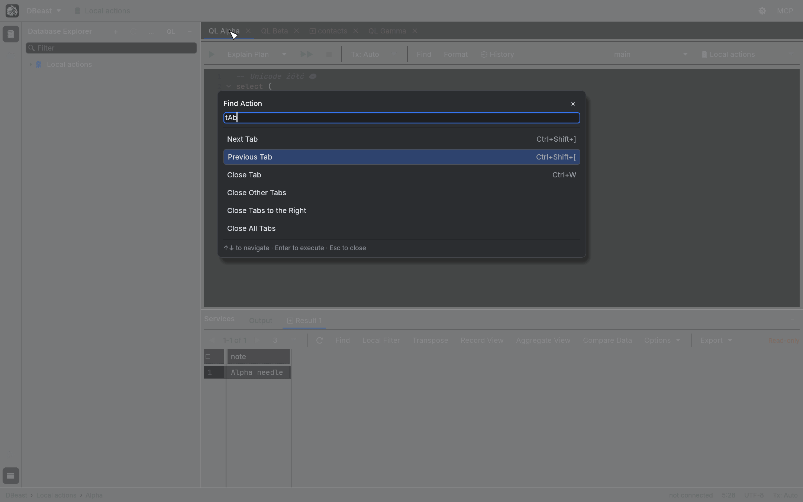

# Getting started

This page walks you through installing DBeast, launching it for the first time, finding your way around the main window and connecting to your first database.

Keyboard shortcuts in this guide use macOS symbols. On Linux, ⌘ is Ctrl and ⌥ is Alt, and the application shows shortcuts in that form (for example, Ctrl+Shift+L).

## Install DBeast

DBeast is a native application with built-in drivers for PostgreSQL, MySQL and SQLite. It does not need a Java runtime or any separate database client libraries.

### macOS

Build the application bundle with the script in the repository:

```sh
./scripts/bundle-macos.sh
open target/release/DBeast.app
```

The script produces `DBeast.app` with its Finder and Dock icon. You can move it to the Applications folder. The bundle is signed locally (ad hoc) and is not notarized.

!!! note
    Because the bundle carries an ad hoc signature, macOS may ask again for access to the saved passwords in the Keychain after you rebuild the application or run a different executable.

### Linux

DBeast builds and runs on Linux. On Debian and Ubuntu, install the build dependencies first:

```sh
sudo apt install build-essential pkg-config libssl-dev libxkbcommon-dev libwayland-dev \
  libx11-dev libxcursor-dev libxrandr-dev libxi-dev libgl1-mesa-dev libegl1-mesa-dev libgtk-3-dev \
  libasound2-dev
```

Then build and start the release binary:

```sh
cargo run --release
```

On Linux the window uses the system title bar and draws with OpenGL.

For full build instructions, see Building from source in the [README on GitHub](https://github.com/macolszewski/dbeast_manager#building-from-source).

### Where settings are stored

| System | Configuration file |
|---|---|
| macOS | `~/Library/Application Support/dev.dbeast.dbeast/config.json` |
| Linux | `~/.config/dbeast/config.json` |

The file is created with owner-only permissions (0600) and never contains passwords; those go to the system credential store (see [Data sources](data-sources.md#password-storage)). To use a different configuration file, set the `DBEAST_CONFIG` environment variable to its path.

## First launch

When DBeast starts, it shows a splash screen with the application name and the tagline "Ultra Fast Database Manager". While the configuration and saved passwords load, the splash shows progress. If macOS asks for access to the Keychain at this point, the splash waits for your answer.



- The splash stays visible for at least 0.8 s. Click or press any key to skip it; that input is not passed on to the editor.
- If loading fails, the splash shows the error and a **Retry** button.

DBeast does not connect to any database at startup. If you worked in DBeast before, your previous tabs, results and Database Explorer state are restored from memory, and a connection opens only when you run a query, refresh, or expand a node that has not been loaded yet. See [Sessions](sessions.md) for details.

On the very first launch the workspace is empty. The Database Explorer shows **No data sources** with a **Create a data source…** link, and the editor area lists the most important shortcuts.



## The main window



### Main toolbar

The toolbar runs along the top of the window. On macOS it replaces the system title bar, with the window buttons on the left; drag an empty part of the toolbar to move the window, or double-click it to maximize.

- **DBeast** menu: About DBeast, Find Action…, Open New Query Console, Data Sources and Drivers, MCP Server, Open File…, the tool windows, Appearance… and Zoom IDE.
- Next to the menu, the data source of the active tab.
- On the right: the gear button opens **Data Sources and Drivers**, and **MCP** opens the MCP server settings (see [AI agents](ai-agents.md)).

### Tool window bar

The narrow vertical bar on the left switches tool windows:

| Tool window | Shortcut | Location |
|---|---|---|
| Database Explorer | `⌘1` | left panel |
| Files | `⌘2` | left panel (replaces Database Explorer) |
| Run | `⌘4` | bottom panel |
| Services | `⌘8` | bottom panel |

Database Explorer and Files share the left panel; opening one hides the other. Run and Services share the bottom part of the window.

### Database Explorer

The Database Explorer shows your data sources as a tree: data source, database, schema, then tables, views, routines and sequences, and inside a table its columns, keys and indexes. Nodes load lazily as you expand them. The header buttons are:

- **+** (New): add a data source or a data source group.
- **Refresh**.
- **…** (More actions): Collapse All, Scroll from Editor, Speed Search Filter, Data Source Properties…, Disconnect.
- **QL**: open a new query console (`⌘⇧L`).
- **−**: hide the panel.

For everything the explorer can do, see [Database Explorer](explorer.md).

### Editor tabs

The central area holds document tabs: SQL consoles and table editors. A dot after a tab name marks unsaved grid changes or an open transaction.

- `⌘⇧[` and `⌘⇧]` switch to the previous or next tab (wrapping around), `⌘W` closes the active tab.
- The tab context menu offers Close Tab, Close Other Tabs, Close Tabs to the Right and Close All Tabs.
- When you close tabs, DBeast warns about pending grid changes, open transactions and non-empty consoles. **Cancel** keeps the whole group of tabs open.

!!! warning
    A closed console is removed from the saved workspace, and there is currently no way to reopen it. DBeast therefore asks for confirmation before closing any console that contains text.

### Services

The Services tool window at the bottom shows the **Output** log of the active console and a tab for each result. See [SQL console](sql-console.md#output-log) for the log format and [Results grid](results-grid.md) for working with results.

### Run

The Run tool window (`⌘4`, or the ▷ button on the tool window bar) lists background tasks such as exports, imports and dump or restore operations. Each task has a tab with progress (rows, bytes, rate, elapsed time and a progress bar), a log of the last 10,000 lines, a **Stop** button and a button that reveals the output file. While a task runs, the status bar shows it with counters and its own Stop button. See [Import and export](import-export.md).

### Status bar

The status bar at the bottom shows:

- on the left, the path to the active document (for example, `DBeast › my-source › console`);
- on the right, the database server and version (or **not connected**), the caret position as `line:column`, the encoding, and the transaction state of the console (for example, `Tx: Auto`, or `Tx: open` while a manual transaction is in progress).

## Find Action

Press `⌘⇧A` (or choose **Find Action…** in the DBeast menu) to search for any command by name.



- Matching is case-insensitive and also uses related keywords, so `tab` finds Next Tab, Close Other Tabs and similar commands.
- Use the arrow keys to choose, Enter to run, and Escape to close and return focus to where it was.
- Each row shows the action's shortcut and, for toggles, its current state.
- Actions that are not available in the current context stay in the list with the reason; they do not run.

Find Action keeps the context of the SQL editor, the grid or the Database Explorer, so grid commands act on the grid you were in.

## Add your first data source

1. Click **Create a data source…** in the empty Database Explorer, click **+** in its header and choose a driver, or click the gear button on the toolbar.
2. In **Data Sources and Drivers**, choose the driver: PostgreSQL, MySQL or SQLite.
3. On the **General** tab, enter the host, port, user, password and database. For SQLite, choose the database file with **Browse…**.
4. In **Save**, choose **Forever** to keep the password in the system credential store, or **Until restart** to keep it only in memory.
5. Click **Test Connection**. On success, the footer shows `Succeeded` with the server version and the connection security.
6. Click **OK**.


The new source appears in the Database Explorer. Expand it to browse the schema, or press `⌘⇧L` to open a query console on it.

For SSH tunnels, SSL/TLS, read-only mode, several databases per source and groups, see [Data sources](data-sources.md).

## Next steps

- [SQL console](sql-console.md): write and run queries.
- [Results grid](results-grid.md): browse, filter and edit data.
- [Files](files.md): open CSV, TSV, Data Package and SQLite files without a configured data source.
- [Keyboard shortcuts](../reference/keyboard-shortcuts.md): the complete list.
