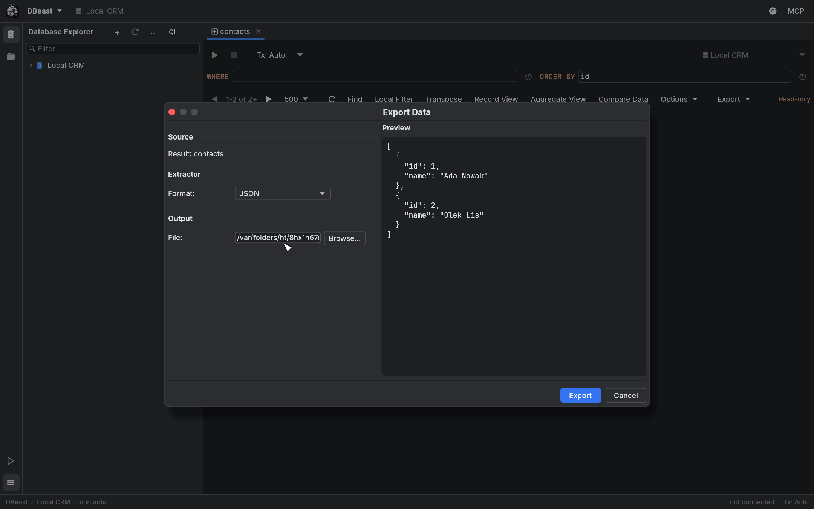
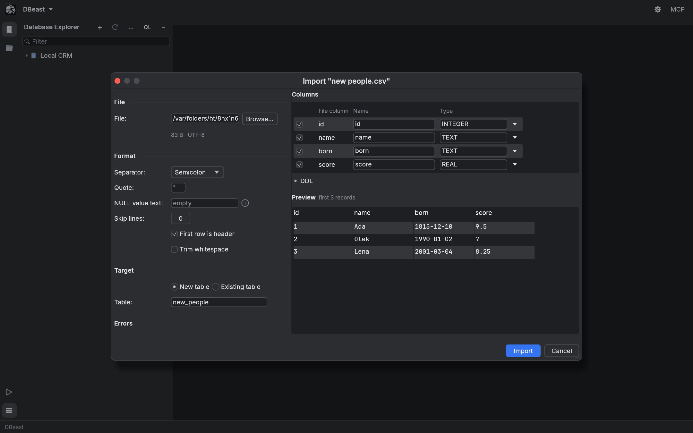
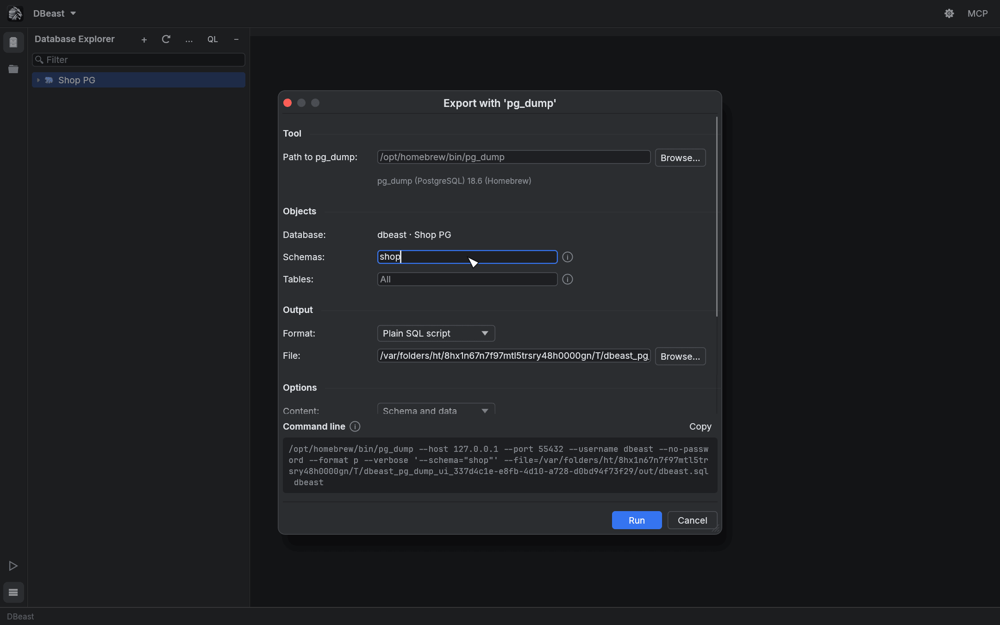
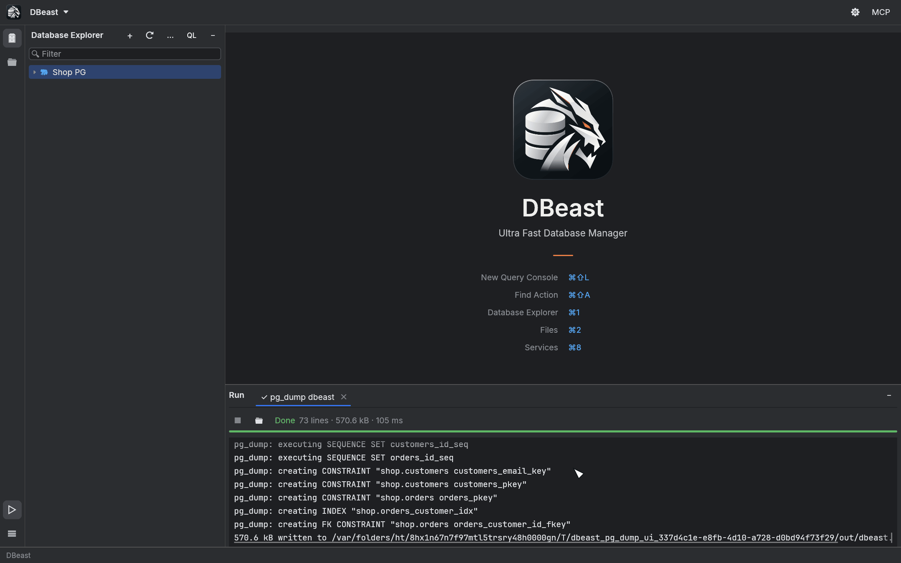
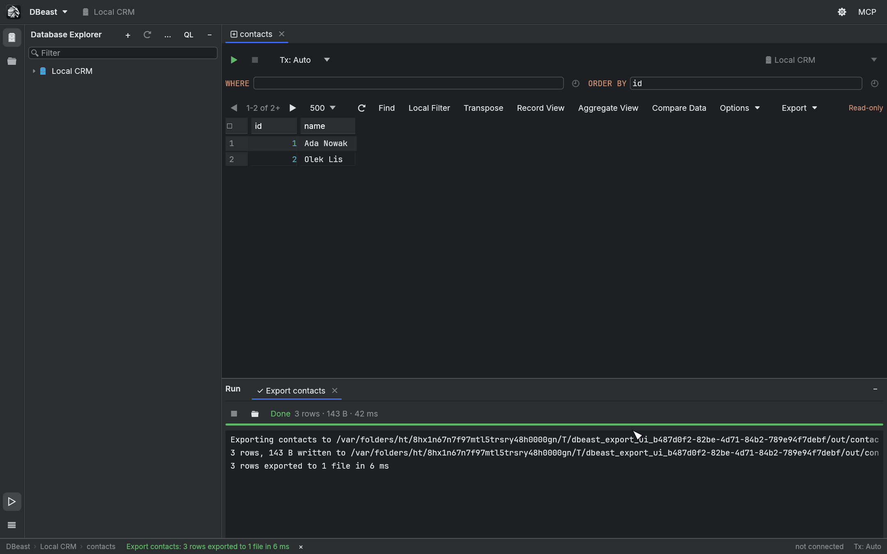

# Import and export

DBeast moves data in and out of databases in the background: exports and imports stream rows without loading the whole table into memory, and PostgreSQL's own `pg_dump`, `pg_restore` and `psql` tools run as background tasks. Progress and logs appear in the [Run](#run-tool-window) tool window.

## Export Data

Open the export dialog from any of these places:

| Where | Menu item | What is exported |
|---|---|---|
| Results grid | **Export ▸ Export Data…** | The whole result |
| Database Explorer, table | **Import/Export ▸ Export Data to File…** | One table |
| Database Explorer, schema or data source | **Import/Export ▸ Export Data to Files…** | The selected tables, each to its own file |

### Formats

- CSV
- TSV
- JSON
- SQL Inserts
- Markdown
- HTML Table
- XML

### Settings

Depending on the format, the dialog offers:

- **Separator:** (Comma, Semicolon, Pipe or Custom),
- **Quote values:** (Always, When needed, Never),
- **NULL value text:**,
- **Add column header**,
- **Line separator:** (LF or CRLF),
- **Rows per statement:** for SQL Inserts,
- **Qualify table name with schema**.

Choose the target **File:** or, for several tables, the **Folder:**. The **Preview** pane shows the first rows in the selected format. For a schema export, pick the tables with **Select All** and **Select None**. Settings and the last folder are remembered.

A grid result is executed again without the page limit, so the file contains the whole result and not only the fetched page. To copy only the fetched page to the clipboard in the same formats, use **Export ▸ Copy as …** in the grid.

PostgreSQL values are written as PostgreSQL prints them: arrays keep their quoting, dimensions and lower bounds, numeric keeps all digits (also `NaN` and `Infinity`), and intervals keep microseconds and the sign of each part, so an exported SQL INSERT loads back into the same column types. If a column has a type DBeast cannot read exactly (for example `money` or `tsvector`), the export stops with an error that names the column and its type, instead of writing a placeholder.

Exporting a whole result recreates its context on a separate connection. It is blocked inside an open transaction, and a PostgreSQL result that uses the temporary-table namespace is rejected. A MySQL export does not recreate temporary tables or other session settings.

### Safe writes and speed

- Rows are streamed in batches of 1,000 through a bounded channel to a separate writer thread with a 1 MB buffer. Memory use does not grow with the size of the table. One million rows from PostgreSQL take about 0.4 s in a release build.
- The file is written under a temporary name and replaces the target only after a successful write. An error or **Stop** never leaves a truncated file and never destroys a previous export.

## Import Data from File

In the Database Explorer, choose **Import/Export ▸ Import Data from File…** on a table, schema, database or data source. After you pick a file, the import dialog opens.

### File format

For CSV and TSV files you can set:

- **Separator:** detected from the first line (Comma, Semicolon, Tab, Pipe or Custom),
- **Quote:**,
- **NULL value text:**,
- **Skip lines:**,
- **First row is header**,
- **Trim whitespace**.

The **Preview** shows the first records of the file.

### Target

- **New table**: the name comes from the file name. Column names and types are detected from the first 1,000 records and can be changed. Expand **DDL** to see the `CREATE TABLE` statement.
- **Existing table**: columns are mapped by name or by position. `<skip>` leaves a column at its default value. **Delete existing rows before import** empties the table first.

### Errors

**On error:** decides what happens with a bad row:

- **Stop and roll back** stops the import and rolls everything back.
- **Skip row** skips bad rows up to **Max errors:**. With **Write errors to file**, rejected rows are saved with their error message to `name.errors.csv`.

The log in the Run window gives the line number in the file for each error.

### How rows are loaded

The file is read as a stream in a separate thread, and rows are sent to the database in batches inside a single transaction:

| Database | Method |
|---|---|
| PostgreSQL | `COPY … FROM STDIN` (one million rows in about 0.8 s) |
| MySQL | Multi-row `INSERT` statements with parameters |
| SQLite | A prepared statement |

Every batch has a savepoint; only a batch that fails is retried row by row. Progress in the Run window counts the bytes read against the file size.

A failed or stopped import leaves nothing in the table, and a newly created table is dropped.

### Non-transactional MySQL tables

MyISAM, MEMORY, CSV, ARCHIVE and other MySQL engines without transactions write every row immediately, so nothing can be rolled back. Before changing anything, DBeast reads the engine of the target table (for a new table, the server's default engine) and, if it is not transactional:

- refuses **Delete existing rows before import** and **Stop and roll back** with an error, without touching the table. Convert the table with `ALTER TABLE … ENGINE=InnoDB`, or choose **Skip row** without deleting existing rows;
- in **Skip row** mode inserts the rows one at a time, without savepoints, so every row is attempted exactly once and the imported and skipped counts are exact. This is slower than batched loading;
- if the import stops early (too many errors, or **Stop**), rows imported up to that point stay in an existing table, and the error says so.

## PostgreSQL dump and restore tools

For PostgreSQL data sources, the **Import/Export** menu in the Database Explorer also offers:

| Action | Available on |
|---|---|
| **Export with 'pg_dump'…** | data source, database, schema, table |
| **Restore with 'pg_restore'…** | data source, database, schema |
| **Restore with 'psql'…** | data source, database, schema |

MySQL (`mysqldump`) is not supported yet.

### The dialog

- **Tool:** the path to the program is detected automatically from `PATH`, Homebrew, libpq, Postgres.app and `/usr/lib/postgresql/*/bin`. You can choose another one with **Browse…**. The detected version is shown under the path.
- **Objects:** schemas and tables (`schema.table`) to include.
- **Output:** format (plain SQL script, custom, directory or tar) and the target file.
- **Options:** schema and/or data, `COPY` or `INSERT` with a row count, `--clean` with `--if-exists`, `--create`, no owner and no privileges, parallel jobs, compression, and any extra arguments.
- **Command line:** a preview of the exact command, with a **Copy** button.

Restore dialogs also offer a single transaction, stop on the first error and parallel jobs. They warn that Clean drops existing objects.

### Credentials and connections

- The password is passed in `PGPASSWORD`, so it never appears in the process arguments or in the log.
- SSL settings are passed in `PGSSLMODE`, `PGSSLROOTCERT`, `PGSSLCERT` and `PGSSLKEY`. Without a CA file, the system trust store is used (libpq 16 or later).
- With an SSH tunnel, the tool connects through the tunnel's local port (`PGHOSTADDR`), and the host name is kept for certificate verification.
- libpq does not accept a PKCS#12 client certificate, so the dialog asks for PEM files instead.

### Running the tool

Click **Run**. The tool runs in the background in the Run window, with its `--verbose` log streamed live (errors in red), the number of log lines and the size of the dump written so far. **Stop** kills the process. The dump is written under a temporary name and replaces the target file only after success; a failed dump leaves nothing behind.

## Run tool window

The Run window collects background tasks: exports, imports, dumps and restores. Open it with `⌘4` (Ctrl+4 on Linux) or the ▷ button on the left sidebar. Run and Services share the bottom part of the window.

Each task has its own tab with:

- progress: rows, bytes, rate, elapsed time and a progress bar,
- the log (the last 10,000 lines; only the visible lines are drawn),
- a **Stop** button,
- **Reveal in Finder** to show the output file.

While a task runs, the status bar shows it with its counters and a Stop button. When it finishes, the result appears as a status bar message and in the Output log of the console that started the export.

