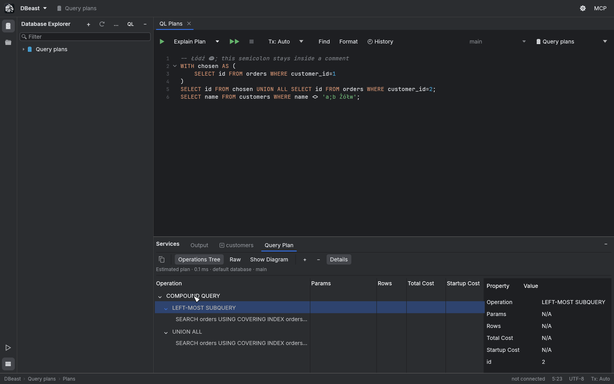
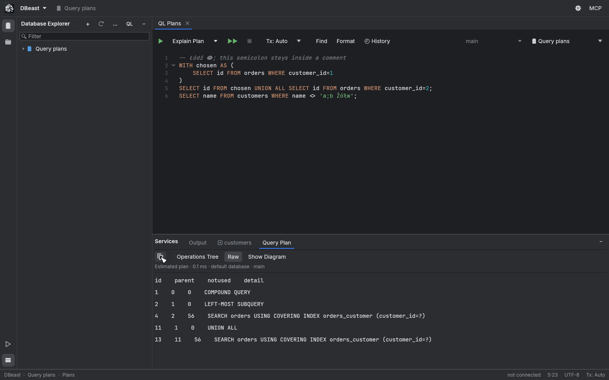
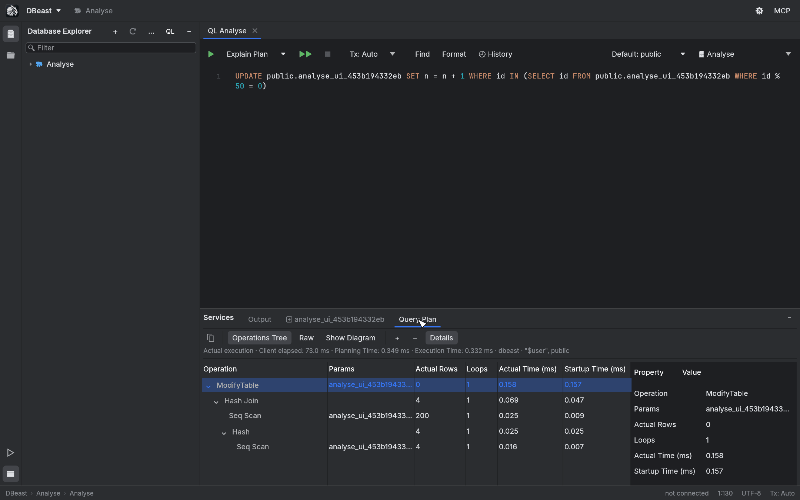
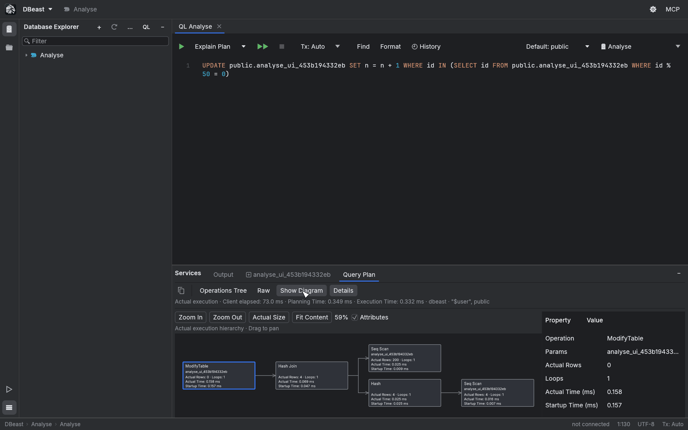
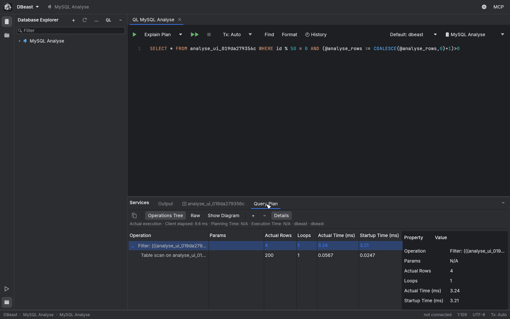
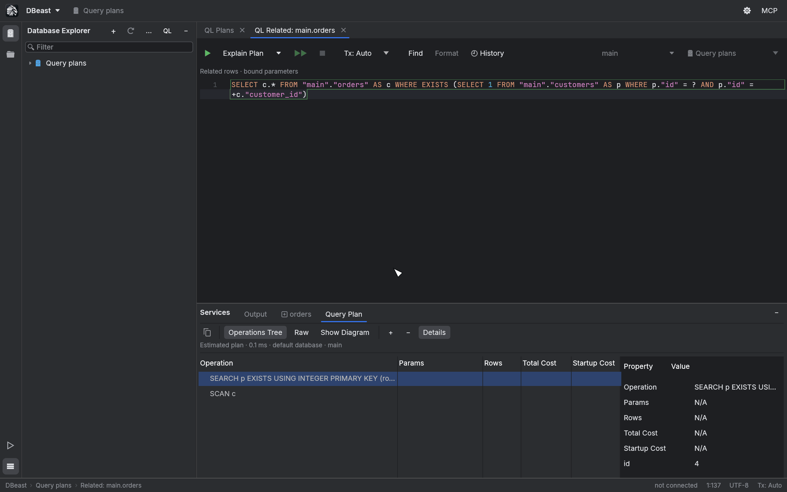

# Query plans

DBeast shows how the database executes a query. **Explain Plan** asks the planner for an estimated plan without running the statement. **Explain Analyse** runs the statement and shows the actual execution: row counts, loops and timings.

| Database | Explain Plan | Explain Analyse |
|---|---|---|
| PostgreSQL | JSON plan | `EXPLAIN (ANALYZE TRUE, FORMAT JSON)` |
| MySQL | JSON plan | `EXPLAIN ANALYZE FORMAT=TREE` (MySQL 8.0.21 or later) |
| SQLite | `EXPLAIN QUERY PLAN` | not available |

## Explain Plan

1. In a console, place the cursor in a statement or select the text you want to plan.
2. Click **Explain Plan** on the console toolbar. The action is also in the editor context menu and in Find Action (`⌘⇧A`, Ctrl+Shift+A on Linux).
3. The plan opens in the **Query Plan** tab of the Services panel. Existing result tabs stay open.

The plan is created in the console's own session, with its schema, temporary tables and transaction. Inside an open transaction, DBeast wraps planning in its own `SAVEPOINT`, so an error or cancellation never affects your earlier changes. Explain Plan does not open a transaction just because the console is in `Tx: Manual` mode. The SQL is validated and sent as a single prepared statement without `ANALYZE`, so it is not executed.

Each console keeps one plan. If planning fails, the previous plan stays visible, together with the SQL and context it was created for, even if you have edited the console since.

## Reading the plan

The Query Plan tab has three views and a properties panel.

### Operations Tree

The default view lists operations as a tree with columns such as Operation, Params, Rows, Total Cost and Startup Cost. Expand and collapse nodes with the mouse, the `+` and `-` buttons or the keyboard. **Details** shows every property of the selected operation.

Costs are planner estimates without a unit; they are not milliseconds. SQLite does not report costs, and missing values are shown as N/A instead of zero.

Large trees are virtualized: only visible rows are drawn, and the index of expanded operations is kept between frames.

### Raw

**Raw** shows the plan exactly as the database returned it. **Copy Original Query Plan** (the copy button at the left of the toolbar) copies the complete plan in the database's own format.

If the structure is unknown or the JSON is invalid, the raw plan is still shown with a message. A preview of a single very long field is limited to 4096 bytes on a UTF-8 boundary; copying always keeps the full text.

### Show Diagram

**Show Diagram** draws the same plan as operation cards connected from left to right.

- Click a card to show it in **Details**. Switching back to Operations Tree reveals the selected operation.
- Drag to pan. **Zoom In**, **Zoom Out**, **Actual Size** and **Fit Content** control the zoom. The camera is kept when you switch views.
- **Attributes** shows Rows and Cost estimates on the cards. After Explain Analyse it shows Actual Rows, Loops, Actual Time and Startup Time on cards of the same size.
- With the diagram focused, the arrow keys move to the previous or next operation, the parent or the first child, and `Home` / `End` jump to the first or last operation.

The layout and spatial index are computed once in the background. Only visible cards and connections are drawn. When you zoom far out, the diagram switches to an overview of operation groups, clearly labeled as such; click a group to zoom into it.

The diagram supports up to 100,000 operations. A larger plan stays fully available in Operations Tree and Raw; it is never truncated. The diagram is part of the Query Plan tab and has no separate editor or image export. Showing the diagram never runs a new query.

## Explain Analyse

!!! warning "The statement is executed"
    Explain Analyse really runs the statement, including DML, CTEs and functions with side effects. Data changes are applied. The action description in the menu says so as well.

Open **Explain Actions** (the arrow next to **Explain Plan**) and choose **Explain Analyse**. It is also in the editor context menu, in the "…" menu of a narrow toolbar and in Find Action. The toolbar button itself always runs the plain Explain Plan; choosing Analyse does not change the default.

### Estimated plan and actual execution

The header of the Query Plan tab says **Estimated plan** or **Actual execution**. For an actual execution it shows the client elapsed time separately from the server's Planning Time and Execution Time.

The Operations Tree shows Operation, Actual Rows, Loops and Actual Time (ms); in a wider window also Params and Startup Time (ms). Estimates (Estimated Rows, Total Cost, Startup Cost) remain in Details and Raw.

- A missing value is shown as N/A, without a unit.
- An operation with zero loops is shown as Not executed.
- Node times are not summed and no percentages are computed from them, because servers report them per loop and including the work of child nodes.
- If the format is unknown, the full Raw output is kept and the statement is not executed again.

### Transactions

- **Tx: Auto** commits the effects like a normal execution.
- **Tx: Manual** with no open transaction issues `BEGIN` and leaves the changes for **Commit** or **Roll Back**.
- Inside an open transaction, Explain Analyse uses its own `SAVEPOINT`. An error or a confirmed cancellation rolls back only the work of Explain Analyse; earlier changes stay.
- A read-only data source rejects changes on the server side.
- Explain Analyse is never retried automatically.

After every possible execution, including errors and late responses, DBeast clears the cached editing, relation and prepared-statement metadata for all sessions of the data source. Earlier results stay as snapshots, their write permission is checked again, and completion metadata is refreshed. The console's current context (for example a `search_path` changed by a function) is read fresh after execution; the plan shows the context from before execution.

### MySQL

MySQL uses `EXPLAIN ANALYZE FORMAT=TREE` in the same session. It requires MySQL 8.0.21 or later and was verified on 8.4.11. MariaDB is not covered.

- Supported statements: `SELECT`, `WITH`, `TABLE`, and the forms of `UPDATE` and `DELETE` that the server accepts. `INSERT` is rejected before execution. Other unsupported forms or versions return the server error, without modifying the SQL and without a retry.
- MySQL measures iterator execution. In tests on 8.4.11, `UPDATE` and `DELETE` did not persist their changes, but a function in a `SELECT` predicate did change data. Explain Analyse is therefore neither a read-only mode nor a substitute for Execute.
- The TREE output keeps the operation text, estimates and actual metrics, including exponent notation and `never executed`. No server time summary is derived from the root time. An unknown or ambiguous structure stays in Raw.
- Rollback applies to transactional changes only. Non-transactional engines and session variables are not rolled back, and an InnoDB deadlock can roll back the whole transaction on the server.

### Stopping and uncertain results

**Stop** cancels the specific request, even before a session has been acquired. Sending the cancel request is not a confirmation; the result of the original operation decides.

MySQL uses `KILL QUERY` and can return a partial TREE with a success response after Stop. In that case the outcome is uncertain: DBeast does not show it as a completed plan, keeps the previous snapshot, closes the session and requires **Disconnect**.

Whenever the outcome is uncertain (a broken connection, failed `SAVEPOINT` cleanup, a cancellation that may have arrived after the SQL finished, or the 5 s recovery limit exceeded), the console session is closed and blocked until you explicitly **Disconnect** and reconnect the data source. **Refresh** alone does not remove the block. In `Tx: Auto` the effects may already be committed, and closing the session rolls back an uncommitted Manual transaction. The message states what is known about the execution and never claims a rollback that did not happen.

## Plans for Related Rows consoles

Explain Plan also works in the parameterized consoles opened by **Related Rows** (see [Results grid](results-grid.md)), and Explain Analyse is available there for PostgreSQL and MySQL.

- The SQL is rebuilt from the saved relation, and the values are bound as typed parameters, never pasted into the text. Selection and cursor position in the SQL preview do not limit the plan.
- A changed data source definition or session context rejects the operation before execution.
- A parameter count mismatch and local PostgreSQL encoding errors (a NUL character in text) are detected before execution and do not close a healthy session.
- A fresh session restores the saved context. No catalog read is needed to prepare the parameters: the plan applies to the saved `SELECT` and the current objects under the saved names, and does not re-confirm that the foreign key exists.

## Limits

- One plan per console. Plans are not saved between application runs.
- No flame graph.
- Custom `EXPLAIN` options and a global shortcut for Explain Analyse are not supported. There is no shortcut for opening the diagram.
- For SQLite, Explain Analyse is disabled and the menu shows the reason.
