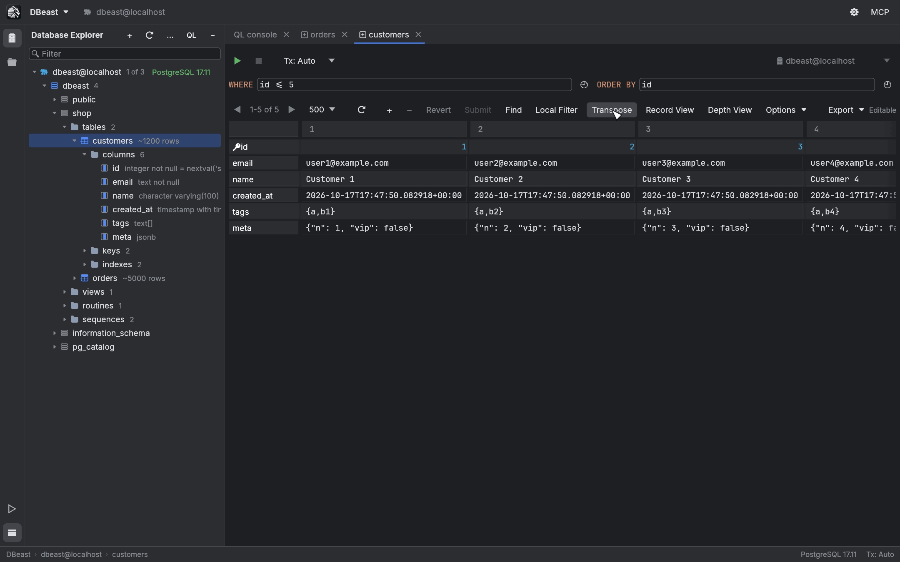
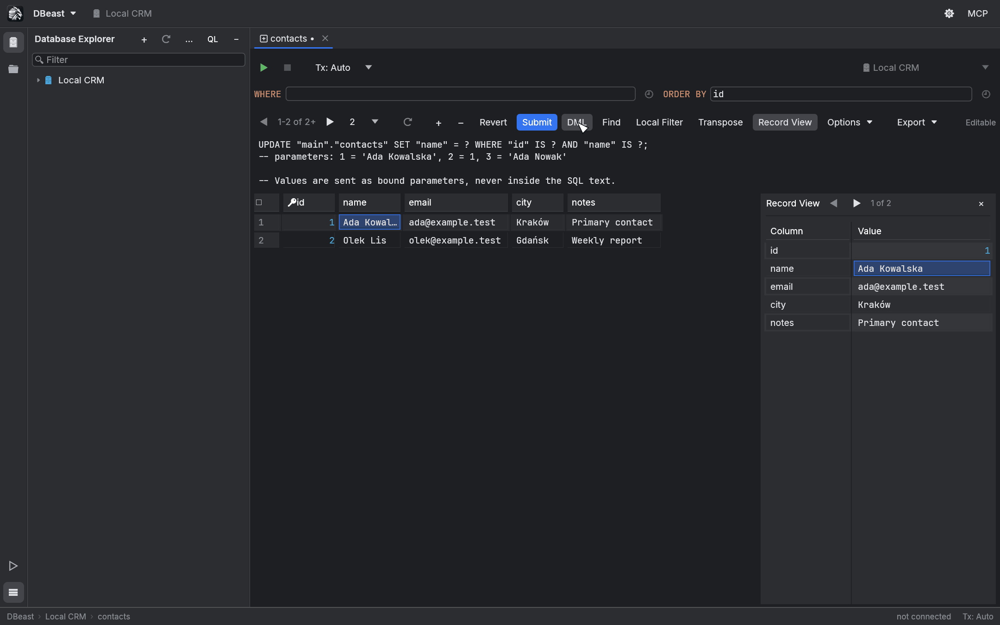
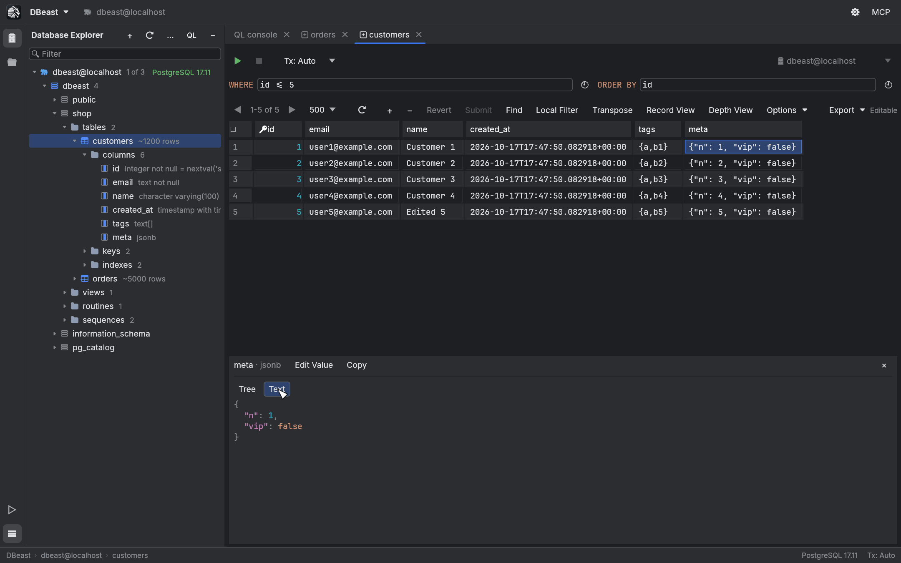
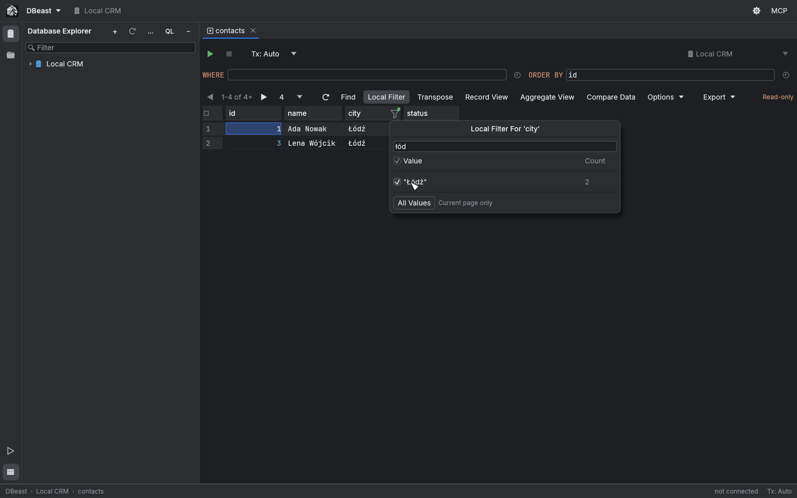
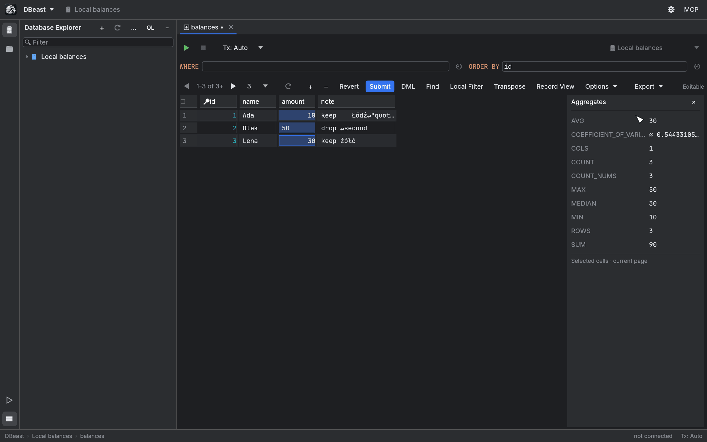
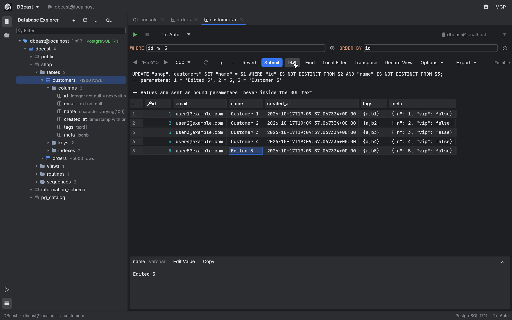
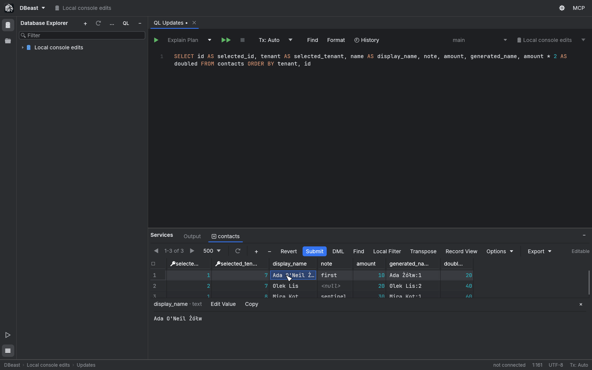
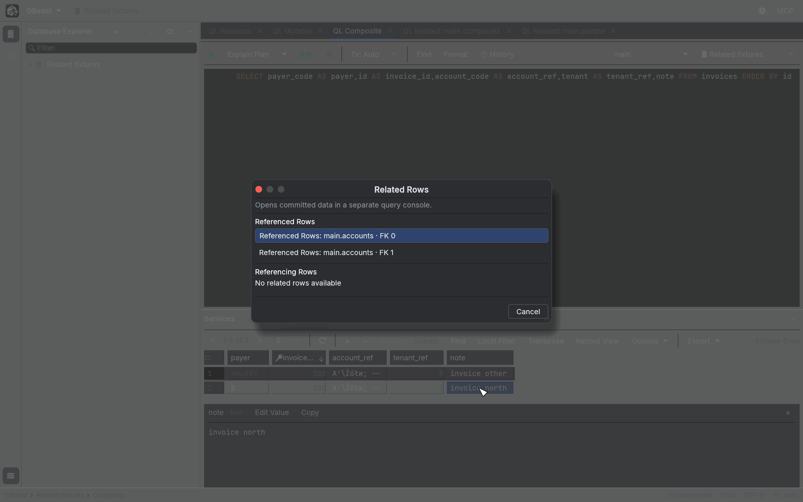
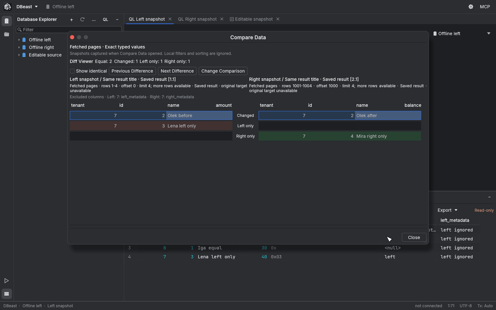

# Results grid

Query results and table data are shown in the results grid. The grid draws only the visible rows, so scrolling stays smooth on large pages. This page covers browsing, searching, filtering, editing and comparing data in the grid.

Shortcuts use macOS symbols; on Linux and Windows, ⌘ is Ctrl.

## Where results appear

- **Console results** open as tabs in the Services tool window, next to **Output**. See [SQL console](sql-console.md).
- **Table data** opens in a table editor tab when you double-click a table or view in the Database Explorer (or select it and press Enter or `F4`). The table editor has **WHERE** and **ORDER BY** fields above the grid; type a condition and press ▶ to reload.

## The grid toolbar

| Control | Purpose |
|---|---|
| ◀ `1-500 of 500+` ▶ | Current row range; previous and next page. |
| Page size | Rows per page: 100, 200, 500 (default), 1000 or 5000. |
| Reload | Run the query again for the current page. |
| **+** / **−** | Add a row / mark the selected row for deletion. |
| **Revert**, **Submit**, **DML** | Discard, save or preview pending changes. |
| **Find** | Find on Current Page. |
| **Local Filter** | Enable column filters in the header. |
| **Transpose** | Show rows as columns. |
| **Record View** | Show the selected record in a side panel. |
| **Aggregate View** | Show aggregates of the selected cells. |
| **Depth View**, Geo Viewer | Visual views of time and geometry columns (see [Visualization](visualization.md)). |
| **Compare Data** | Compare two open results. |
| **Options** | Grid settings such as Show Value Editor and Clear Local Filter For All Columns. |
| **Export** | Export Data… and Copy as… (see [Import and export](import-export.md)). |

The right end of the toolbar shows whether the result is **Editable** or **Read-only**. For a read-only console result, a line under the toolbar explains why. In a narrow window, extra actions move into the **Options** menu, so paging, Submit and Revert stay visible.

## Reading the grid

- Row numbers are shown on the left. `NULL` values appear as `<null>`.
- Numbers are right-aligned and colored.
- The primary key column has a key icon in its header.
- Alternate rows have a slightly different background.

### Sorting

Each column header has a separate sort control that appears when you hover over the header or when the column is sorted. Click it to cycle between ascending, descending and unsorted. Sorting is applied to the fetched page, without another query. Clicking the column name itself selects the column.

To sort in the database, use `ORDER BY` in your query or in the table editor's **ORDER BY** field.

### Paging

Results are fetched one page at a time, 500 rows by default. Use ◀ and ▶ to move between pages, and the page size menu to change the number of rows. The range label shows `+` when more rows are available.

A table opened from the Database Explorer asks the database for the current page only: DBeast adds `LIMIT` (one row more than the page, to know whether another page exists) and `OFFSET` to the table's SELECT, so a page at the end of a large table costs about as much as the first one. Without an **ORDER BY** in the table editor, rows are ordered by the primary key, so a page shows the same rows every time. **Export Data** still exports the whole table.

A console query is run as written, and moving to another page runs it again. DBeast reads the page and the row after it, so an error in that row is never shown as a successful result. When more rows follow, a plain read (a SELECT without data-modifying statements and without calls to functions other than common built-in ones) outside a transaction is stopped on the server with a cancel request. Any other statement is read to the end and the extra rows are discarded: an error in a later row is reported, and a statement that changes data, such as `INSERT … RETURNING`, always runs to completion. On MySQL the rest of a console result is always read to the end.

## Transpose

Click **Transpose** on the grid toolbar, or choose it in the cell context menu, to show columns as rows and records as columns. This is useful for wide tables with few rows.

Editing, selection, Find and filters all work in the transposed view. The setting is remembered for each tab.

## Record View

Record View shows one record as a list of column and value pairs in a panel to the right of the grid. Open it with:

- **Record View** on the grid toolbar;
- **Show Record View** in the cell context menu;
- `⌘⇧↵` while the grid has focus.

- ◀ and ▶ move to the previous and next record, following the current sort order.
- Press Enter or double-click a value to edit it. Changes join the same pending changes as edits in the grid, with the same colors, DML preview, Submit and Revert.
- The panel stays open after a reload and after restarting DBeast.

## Value editor and JSON

Selecting a cell shows its full value in the value panel below the grid. The panel header shows the column name and type, with **Edit Value** and **Copy**.

- JSON values can be shown as **Tree** (collapsible objects and arrays) or **Text** (formatted with syntax coloring). Keys keep their original order.
- **Edit Value** opens an edit buffer. **Apply Value** adds the change to the pending changes, **Cancel Value Edit** discards it, and **Submit** saves it to the database. Enter in this field inserts a new line.
- Close the panel with ×, or turn it off with **Options** > **Show Value Editor**. **Open in Value Editor** in the cell context menu, or `⇧↵`, shows it again.

Binary values do not have a hex editor yet.

## Selecting and copying

| Action | How |
|---|---|
| Select a cell | Click it, or move with the arrow keys. |
| Extend the selection to a rectangle | Shift+click, Shift+arrow keys, or drag. Dragging near the edge scrolls the grid, also in Transpose. |
| Select a column / a record | Click the column name / the row number. |
| Select all cells of the page | `⌘A` |
| Copy | `⌘C` |

`⌘C` copies the selected range without headers, in the visible order (after sorting, filtering and Transpose), and includes pending changes. Fields are quoted as TSV when needed, so tabs, new lines and quotes survive pasting. A single cell is copied as its raw value. **Copy row (TSV)** in the context menu copies the whole row, also including pending changes. To copy the page in another format, use **Export** > **Copy as…**.

Grid shortcuts work only while the grid has focus, so they never interfere with typing SQL or filters.

## Find on Current Page

Press `⌘F` in the grid, click **Find**, or choose **Find on Current Page** in the cell context menu. The search field is prefilled with the selected value.

- Matching cells are highlighted and a counter shows the current match and the total.
- **Cc** toggles Match Case and **W** toggles whole Words.
- `⌘G` / `⌘⇧G`, or Enter / Shift+Enter in the search field, move to the next or previous match, wrapping around.
- **Filter rows** hides records without a match, also in Transpose and Record View.

Find searches the full text of the fetched page, including pending changes, `<null>` and `<default>`. Binary values are searched by their visible hex prefix. Regular expressions are not supported. The pattern and options are kept when you reload or change pages. Find never queries the database and does not change what Export writes.

!!! note
    New rows that you have not submitted yet stay visible under **Filter rows** even without a match, so that you can finish adding them. Rows marked for deletion are still searched until you submit.

## Local column filters

Click **Local Filter** to show filter icons in the column headers. Click a column's filter icon to open **Local Filter For '<column>'**.

- The popup lists the distinct values on the page and how many times each occurs. Type to narrow the list, and check the exact values you want to keep.
- Conditions on several columns are combined with AND.
- **All Values** removes the condition for one column. **Options** > **Clear Local Filter For All Columns** removes all of them. Turning **Local Filter** off keeps the settings for later.

Filters work on the fetched page, take pending changes into account, and apply to console results, Transpose and Record View. Find searches only the records the filters let through. New rows stay visible until you finish editing them.

Comparison is exact and local, independent of database collation: types and letter case are distinguished, text values are shown in quotes to tell them apart from `NULL` or numbers, and decimals keep their written form and scale. When you change pages, selected values are kept for columns with the same name and type. A value that does not occur on the new page still counts as a condition, so the result may be empty. Local filters are not saved between launches.

## Aggregate View

Select cells and click **Aggregate View**, or choose **Show Aggregate View** in the cell context menu. The **Aggregates** panel opens on the right, in place of Record View.

| Aggregate | Meaning |
|---|---|
| AVG | Average of numeric cells. |
| COEFFICIENT_OF_VARIATION | Population standard deviation divided by the absolute value of the average. Not available when the average is zero. |
| COLS / ROWS | Number of columns / rows in the selection. |
| COUNT | Number of cells, including `NULL` and `DEFAULT`. |
| COUNT_NUMS | Number of numeric cells. |
| MAX, MEDIAN, MIN, SUM | As named. |

- Numeric aggregates ignore text, boolean and binary values. DBeast does not guess numbers from text.
- Integer and decimal values use exact decimal arithmetic with range and precision checks. Approximate results, such as those involving floating-point numbers, are marked with `≈`.
- Invalid numbers, NaN, infinity and overflow are reported explicitly instead of showing a wrong result.
- Aggregates cover the current page only. The panel stays open when you change pages and after a restart.

## Editing data

You can edit table data in the table editor and, under certain conditions, the results of console queries.

### Making changes

- Double-click a cell, or press Enter, to edit it. Enter confirms, Escape cancels.
- **+** or **Add Row** (`⌘N`) adds a row. **−** or **Delete Row** (`⌘⌫`) marks the selected row for deletion. **Clone Row** (`⌘D`) adds a copy of the selected row, including its unsaved changes; primary key columns and columns the grid cannot set are left at their default.
- **Set NULL** and **Set DEFAULT** in the cell context menu set those values.
- Row shortcuts work on the selected cell when no text field has keyboard focus.

Changed cells are blue, new rows green, and rows to be deleted red and struck through. Before you switch tabs, a cell being edited is added to the pending changes (it is not submitted).

### Submitting

- **DML** shows the generated `UPDATE`, `INSERT` and `DELETE` statements with parameters, and a comment with the parameter values. The preview is for reading only.
- **Submit**, or `⌘↵` while the grid has focus, saves all pending changes.
- **Revert** discards them.

DBeast saves changes safely:

- Values are always sent as bound parameters, never inside the SQL text.
- Before saving, the table metadata is checked again.
- A row is identified by its original primary key. `UPDATE` also compares the previous values of the changed cells, and `DELETE` compares all comparable columns of the row. If someone else changed the row in the meantime, you get a conflict instead of silently overwriting or deleting their change. For columns that cannot be compared in SQL (for example `json`, arrays or PostGIS types), only the key detects conflicts.
- Each statement must affect exactly one row. Any error, conflict or uncertain outcome rolls back the whole batch; inside an open transaction this uses a savepoint, so your earlier changes in the transaction are kept.
- In **Tx: Manual** mode, a successful save stays in the open transaction until you commit.
- If the connection is lost during a save, DBeast does not retry. The result becomes read-only and keeps your values for reference until you verify the database with a fresh query.

### When a table is read-only

- A table without a primary key is read-only, because identical rows cannot be told apart. The reason is shown in the grid. Exception: an SQLite table with a hidden `rowid` (including an imported CSV file) gets an extra read-only `rowid` column and is identified by it.
- MySQL tables without transactions (for example MyISAM) are read-only, because a failed batch could not be rolled back.
- A table tab restored from a previous session shows the saved rows without connecting. The first edit reloads the current page, and you can then edit the fresh result.

### Editing console results

A console result is editable when it comes from a simple `SELECT` on one table and contains the table's complete primary key. You can then update cells and use Add Row, Clone Row and Delete Row, with the same safeguards as the table editor.

- Column aliases and column order do not matter: the physical column names come from the driver protocol and the database catalog.
- Computed and generated columns, and values without a lossless representation, are read-only.
- A missing or incomplete key, or an ambiguous result, makes the result read-only with a visible reason.
- Changing the console's data source, schema or connection revokes write access to older results.
- Results restored from a session must be executed again before editing.

Out of scope for now: joins, CTEs, aggregates, compound queries and function calls in the select list, virtual keys, choosing the target table manually, and typing SQL expressions into cells. PostgreSQL supports regular tables without inheritance or partitioning; MySQL supports permanent InnoDB tables only; SQLite also supports qualified tables of attached databases, but not virtual tables.

## Related Rows

Related Rows follows foreign keys from the selected record. Open it with:

- **Go To** > **Related Rows** in the cell context menu;
- `F4` while the grid has focus;
- Find Action.

The chooser lists **Referenced Rows** (records the current row points to through its foreign keys) and **Referencing Rows** (records that point to the current row). It is always shown, even when there is only one relation. Use the arrow keys to choose, Enter to open, and Escape to close.

The selected relation opens in a new console named `Related: schema.table`, with parameterized SQL. Execute, Reload, paging and export keep the same typed values. Related Rows results are read-only and show committed data from a separate session.

Things to know:

- All columns of a composite key are used, in catalog order, including foreign keys that reference a UNIQUE constraint. Aliases in the `SELECT` do not affect the mapping.
- The source result can be read-only and does not need its own primary key, but it must contain the complete, exact values of the chosen relation. `NULL` values, a missing part of the key, or unsubmitted changes are reported as a reason.
- Foreign keys are read only when you invoke the action, in the background, and cached per session.
- Not supported yet: an open transaction in the source console, temporary tables, SQLite attached and in-memory databases, imported file sources, virtual foreign keys, inline preview, and navigating from several records at once. SQLite foreign keys appear as `FK n`, because SQLite does not return constraint names.

## Compare Data

**Compare Data** on the grid toolbar (also in its menu and in Find Action) compares two open results.

1. Choose the two results. The dialog shows their sources and fetched ranges.
2. Check the column mapping. Columns are matched by exact name; you can change the mapping, and excluded columns are listed.
3. Choose the key columns that identify a row. A composite key is supported.
4. The **Diff Viewer** shows both sides with synchronized scrolling, highlights changed cells, and counts **Equal**, **Changed**, **Left only** and **Right only** rows. **Show identical** includes unchanged rows; **Previous Difference** and **Next Difference** jump between changes; **Change Comparison** returns to the setup.

How the comparison works:

- The comparison uses **fetched pages**: a snapshot of each result taken when Compare Data opens, independent of local sorting and filters. "Left only" means the key is missing from the other fetched page, not from the whole table.
- It works with read-only results and results restored from a session. Submit or revert pending edits first. Compare Data never writes data and never fetches more rows.
- The key must be unique on both sides, without `NULL` or NaN.
- Values are compared by type and full content, without database collation: `1`, `1.0` and the text `"1"` are different, and decimals keep their written form and scale. Floating-point zeros of either sign are equal, and NaN values outside the key are treated as equal.
- Tolerances, column insertion detection and data synchronization are not available. Comparisons are not saved between launches.
