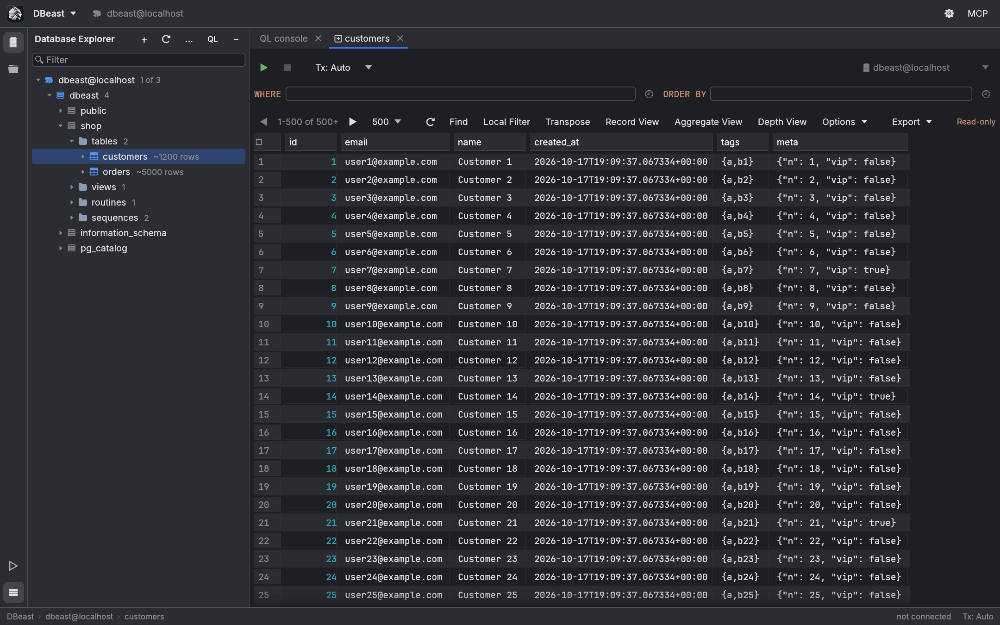

# Sessions and configuration

DBeast remembers your working session. When you start it again, the same tabs, results and Explorer tree come back, without connecting to any database until you need one.

## What is restored

After a restart DBeast restores:

- the open tabs:
    - consoles with their content, cursor position and folded code,
    - table editors with their `WHERE` and `ORDER BY` filters,
- the active tab,
- the last results, including sorting and Transpose,
- the state of the Record View and Aggregate View panels,
- the Output log,
- the expanded Database Explorer tree,
- the default schema selected in each console,
- saved Database Graph layouts (settings and pinned objects, no data).



## Working offline after a restart

DBeast does not connect at startup. Restored data is shown from the saved session, and a connection opens only when you run a query, refresh, or expand a tree node that has not been loaded. The status bar shows "not connected" until then.

Some restored content needs a fresh read before you can change it:

- A restored table tab shows the saved rows. The first edit reloads the current page, and only the fresh result can be edited.
- Restored console results need to be executed again before they can be edited.
- A restored Related Rows console keeps its parameters but not the write permission or column origin of the previous session.
- Restoring a console's schema selection does not open a connection.

## The session file

The session is stored in `session.json` next to the configuration file, and the rows of saved results in the `session-results` folder beside it, one file per result. The files have 0600 permissions because they contain query results.

It is written at most every 2 seconds after a change, and when the application closes. The rows of a result are written once, in the background; later saves rewrite only `session.json` and remove files of results that are no longer open. On start, the session is read in the background and the tabs appear when it has been read. A `session.json` from an earlier version, which held the rows itself, is still restored.

!!! note "Closing a console discards its content"
    The content of a closed console is removed from the saved session, and there is no recovery of closed consoles yet. DBeast therefore asks for confirmation before closing any console that is not empty.

## Configuration file

The configuration (`config.json`) stores data sources, query history, recently used table filters (up to 20 per table), appearance settings, the Zoom IDE level, the Explorer layout (groups and order) and other preferences.

| System | Default location |
|---|---|
| macOS | `~/Library/Application Support/dev.dbeast.dbeast/config.json` |
| Linux | `~/.config/dbeast/config.json` |
| Windows | `%APPDATA%\dbeast\dbeast\config\config.json` |

The file is written with 0600 permissions, in the background, about half a second after changes pause (at most every 2 seconds while you keep typing) and when the application closes. If a configuration from an earlier version of the application exists at its older location, DBeast keeps using that path, because saved passwords in the system keychain are bound to the location of the file.

Files stored next to the configuration:

- `session.json` and the `session-results` folder, the working session,
- `known_hosts`, the SSH host keys remembered on first connection (separate from `~/.ssh`),
- `config.json.credentials-pending.json`, present only during a password migration. It contains identifiers of leftover entries from the old storage format, never passwords. Do not delete it manually after a migration error.

### Using another configuration with DBEAST_CONFIG

Set the `DBEAST_CONFIG` environment variable to the path of a configuration file to use a different one:

```sh
DBEAST_CONFIG=/path/to/test-config.json ./target/release/dbeast
```

The session file and other companion files are then stored next to that file. This is useful for testing and for keeping separate setups apart. The tests also use it, so they never touch your real configuration.

!!! warning "Passwords are bound to the original location"
    Saved passwords are tied to the canonical location of the configuration file. A copy of the file in another location cannot read or delete the passwords of the original. After moving a configuration, restore its original path. An independent configuration needs a new vault and the passwords entered again. See [Data sources](data-sources.md) for how passwords are stored.

### Saving and errors

- Configuration and the system keychain are accessed off the interface thread, with an atomic write and a lock that prevents overwriting changes made by another DBeast instance.
- When you close the window, DBeast waits for a pending configuration write to finish. **Exit without waiting** closes the application without that guarantee.
- After a write error, **Reload settings and discard changes** replaces your draft with the saved settings, but only if the read succeeds; a failed read keeps your unsaved changes. Changed or removed data sources are disconnected and not reconnected automatically.
