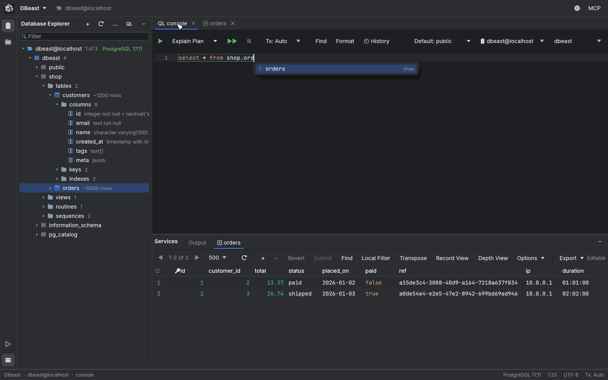
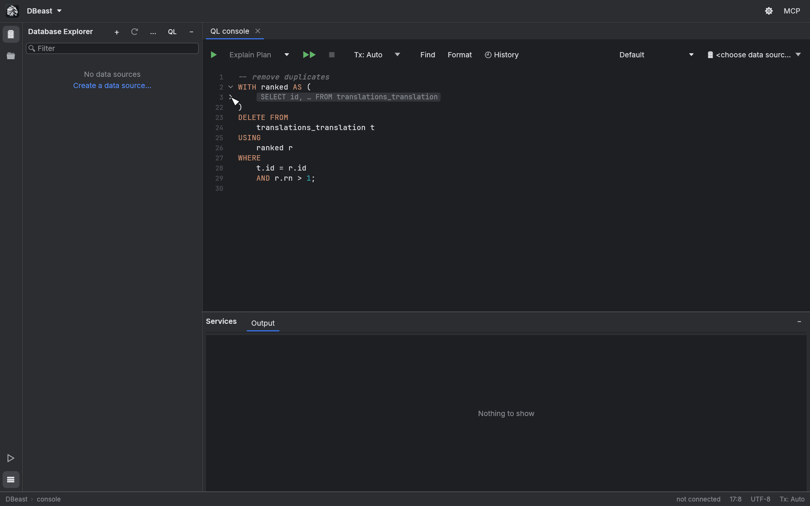
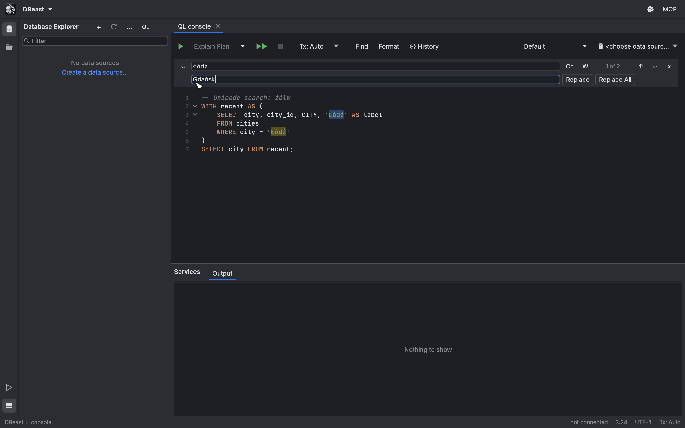
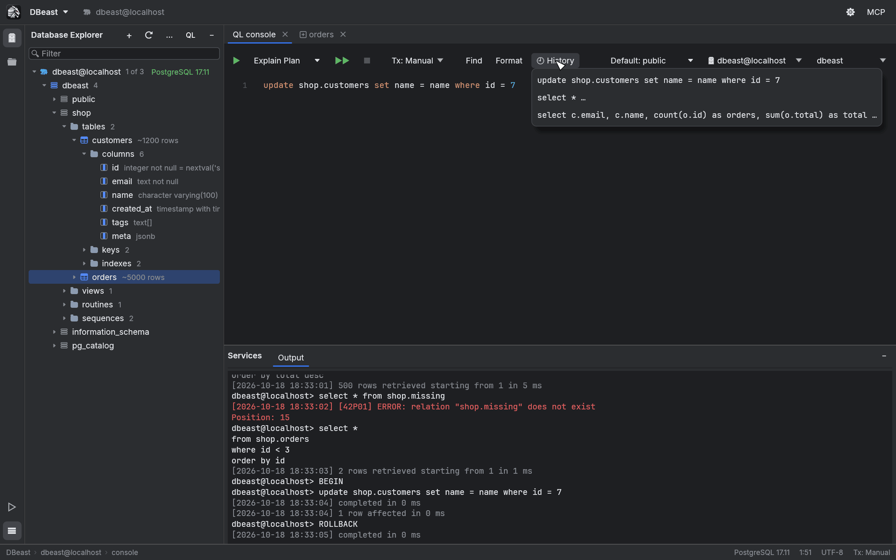
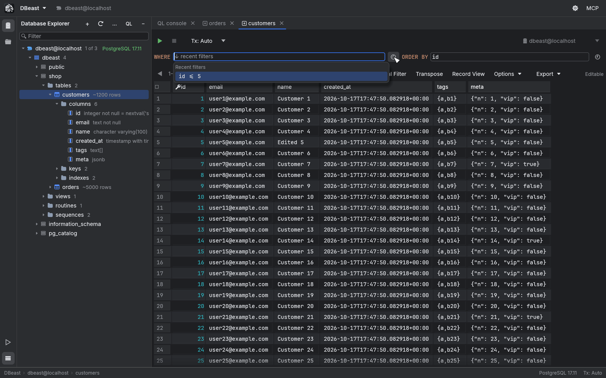
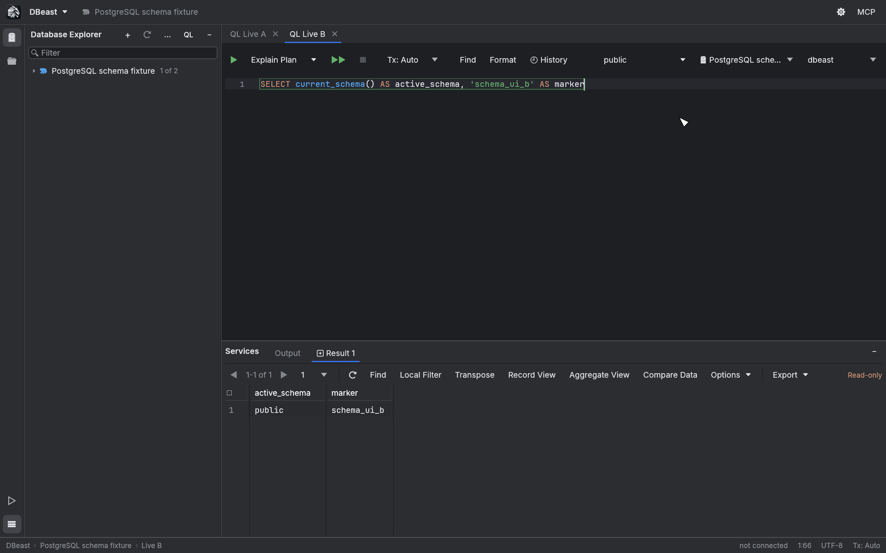
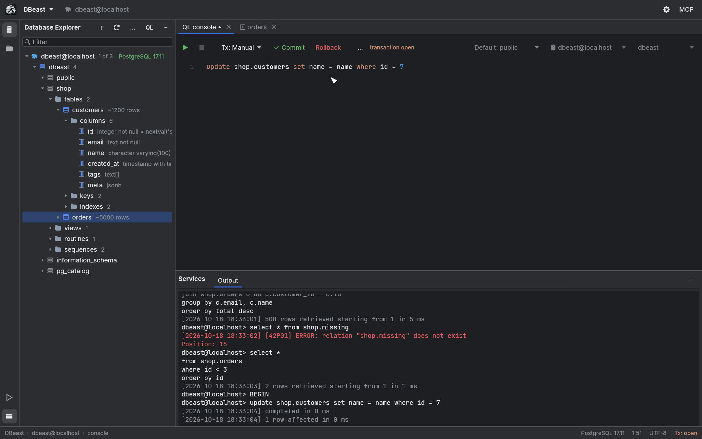

# SQL console

The query console is where you write and run SQL. Each console is a tab with its own database session, so a long-running query in one console never blocks browsing the schema or working in another console.

Shortcuts use macOS symbols; on Linux, ⌘ is Ctrl and ⌥ is Alt.

## Open a console

- Press `⌘⇧L`, or click **QL** in the Database Explorer header.
- Choose **Open New Query Console** in the DBeast menu or in Find Action (`⌘⇧A`).
- Use a database's context menu in the Database Explorer to open a console in that database (see [Database Explorer](explorer.md)).

The console toolbar, from left to right:

| Control | Purpose |
|---|---|
| ▶ Execute | Run the statement under the caret or the selection (`⌘↵`). |
| Explain Plan, Explain Actions ⏷ | Show the query plan (see [Query plans](query-plans.md)). |
| ▶▶ Execute Script | Run the whole script (`⌘⇧↵`). |
| ■ Stop | Cancel the running statement (`⌘F2`). |
| Tx: Auto / Tx: Manual | Transaction mode. |
| Find | Find, Replace and Go to Line/Column. |
| Format | Reformat SQL (`⌥⌘L`). |
| History | Statements previously run on this data source. |
| Default schema | Schema (PostgreSQL) or database (MySQL) for this console. |
| Data source, database | Where the console runs. |

In a narrow window, less frequently used actions move to the **More Console Actions** (**…**) menu. The data source and schema selectors always keep their place.

## Run SQL

### Statement under the caret

Press `⌘↵` or click ▶ to run the statement under the caret. That statement has a green outline from its first to its last character, so you always see what will run.


If you select text, the outline disappears and `⌘↵` runs exactly the selection.

### Whole script

Press `⌘⇧↵` or click ▶▶ to run every statement in the console from top to bottom. Execution stops at the first error.

DBeast splits scripts into statements with awareness of each SQL dialect: string literals, quoted identifiers, comments (nested comments in PostgreSQL), PostgreSQL `$tag$` bodies and `E'...'` strings, MySQL `DELIMITER`, SQLite trigger bodies and semicolons inside parentheses are all handled correctly.

### Results

Query results open as tabs in the Services tool window, next to **Output**. Results are fetched in pages of 500 rows by default. See [Results grid](results-grid.md).

Each result remembers the data source, database and schema it came from, and the server context confirmed after execution. If you change the console's data source, database or schema afterwards, **Reload** and fetching the next page refuse to run until you switch back or run the SQL again. Context changes made with `SET` or `USE` in SQL are detected too.

## Stop a running statement

Press `⌘F2` or click ■ to cancel the running statement. DBeast sends a cancel request to the server (PostgreSQL cancel request, MySQL `KILL QUERY`, SQLite interrupt), closes the console session and unlocks the console.

!!! warning
    After Stop, the outcome of the statement may be unknown, and an open manual transaction is lost. Disconnect and reconnect the data source before continuing, and verify any changes before retrying. DBeast never retries automatically. See [Connection recovery](data-sources.md#connection-recovery-and-keepalive).

## Code completion

Completion suggests names based on where the caret is in the statement.



- After `FROM`, `JOIN` or `UPDATE`: tables and schemas.
- After `alias.` or `table.`: columns of that table. After `schema.`: tables in that schema.
- In `ORDER BY` after a column: `ASC`, `DESC`, `NULLS FIRST`.
- In `WHERE` after a column: operators such as `IS NULL`, `IN`, `LIKE`; after a value: `AND`, `OR`.

Press `Ctrl+Space` to open the list (Ctrl on every system). Use the arrow keys to choose, Enter or Tab to insert, Escape to close.

Completion also works in the **WHERE** and **ORDER BY** fields of the table editor. Metadata is loaded in the background, once per data source (and per PostgreSQL database), and cached. Unqualified names are resolved according to the schema search order confirmed for the console; tables outside that order, or hidden by a table of the same name earlier in the order, are inserted with a qualified name. Quoted identifiers and aliases keep their case. Refreshing the data source reloads the metadata.

## Code folding

Fold markers (˅) in the gutter appear next to multi-line statements and the contents of parentheses (subqueries, CTEs, `OVER (…)`).



- A folded region shows a summary badge, such as `SELECT id, … FROM translations`. Line numbers skip the hidden lines.
- Click the badge or › to unfold.
- `⌘-` / `⌘=` fold or unfold the region under the caret. `⌘⇧-` / `⌘⇧=` fold or unfold everything.

Execution, saving, history and copying always use the full text. Backspace or Delete on a folded region unfolds it instead of deleting the hidden text.

## Format SQL

Click **Format** or press `⌥⌘L` to format the selection, or the whole console when nothing is selected. The formatter:

- puts each clause keyword (`SELECT`, `FROM`, `WHERE`, `GROUP BY`, `ORDER BY`, `LIMIT`, `SET`, `VALUES` and others) on its own line, with its content indented by 4 spaces below it;
- puts each comma-separated list item and each `AND` / `OR` condition in `WHERE` and `HAVING` on its own line (`BETWEEN … AND …` stays together);
- indents `JOIN … ON …` under `FROM` and puts `UNION ALL` on its own line;
- formats subqueries and `OVER (…)` as nested blocks, while function calls and `IN (…)` lists stay on one line;
- uppercases reserved keywords only; function names and identifiers are left as they are;
- never touches literals, comments or `$$ … $$` bodies.

Every result is compared with the original token by token. If formatting would change anything other than whitespace and keyword case, it is rejected and the SQL stays unchanged.

## Find, Replace and Go to Line

| Shortcut | Action |
|---|---|
| `⌘F` | Open the find bar. Selected text fills the search field. |
| `⌘R` | Open the find bar with the replace field. |
| `⌘G` / `⌘⇧G` | Next / previous match, wrapping around. Enter and Shift+Enter in the search field do the same. |
| `⌘L` | Go to Line/Column. |
| Escape | Close the find bar or the Go to dialog and return to the SQL. |

The same commands are in the **Find** menu on the console toolbar.



- **Cc** toggles Match Case and **W** toggles whole Words. The counter shows the current match and the total; all matches are highlighted.
- **Replace** replaces the current match, **Replace All** replaces every match in one undoable step.
- Replacement is literal: `$` and backslashes have no special meaning. Regular expressions, search in selection and Preserve Case are not supported.
- A match inside a folded region unfolds it and scrolls the editor to it.
- Case-insensitive matching uses Unicode lowercase, without full case folding (`ß` does not match `ss`).

**Go to Line/Column** accepts a line number or `line:column`, counting from 1. A column past the end of the line stops at the end of the line; an invalid number keeps the dialog open with a message.

## Undo and Redo

`⌘Z` undoes and `⌘⇧Z` redoes changes in the console, including replacements and edits around folded code. Undo and Redo unfold the code so that the restored selection is visible. History is kept separately for each tab, in memory, until the tab is closed.

## Query history

Every statement you run is remembered per data source (up to 300 entries; running the same statement again moves it to the top). Click **History** on the console toolbar to see the list. Choosing an entry appends it to the end of the console.



## Filter history in the table editor

Double-clicking a table opens it in the table editor, which has **WHERE** and **ORDER BY** fields above the grid. Both fields remember the last 20 filters for each table. The list opens when you focus an empty field, press the down arrow, or click the 🕘 button. Choosing an entry applies the filter immediately.



## Default schema per console

The **Default schema** selector on the console toolbar sets the current schema (PostgreSQL) or current database (MySQL) for that console only, on its existing connection.



- The list includes empty schemas and has a search field.
- **Default** restores the connection's real initial context, including a custom `search_path`.
- For SQLite the selector shows `main` and is disabled; `temp` and attached databases are available through qualified names.
- The choice is saved with the configuration and the session. Restoring the window does not open a connection.
- Selecting the same data source or database again does not reset the schema or the caret.
- You cannot change the schema, data source or database while a query, transaction, file save or pending grid change is in progress. If the change fails, the previous selection stays.

## Transactions

Choose the transaction mode in the **Tx** menu on the console toolbar:

| Mode | Behavior |
|---|---|
| **Tx: Auto** | Every statement is committed automatically. |
| **Tx: Manual** | The first statement opens a transaction. **Commit** and **Rollback** on the toolbar end it. |



While a transaction is open, the console tab shows a dot after its name, the toolbar shows **transaction open**, and the status bar shows `Tx: open`. Closing the tab rolls the transaction back; DBeast warns you first.

The transaction indicator follows the server's real state after every statement. MySQL commits implicitly before DDL (`CREATE`, `ALTER`, `DROP`, `TRUNCATE` and similar statements), so:

- When such a statement commits a transaction that contained changes, the Output log says **Transaction committed implicitly by this statement**, and the console no longer shows an open transaction. Those changes can no longer be rolled back.
- In **Tx: Manual**, the next statement opens a new transaction, also in the middle of a script; the Output log notes it. **Rollback** therefore always undoes the changes made after the implicit commit.
- When a statement fails and the server ends the transaction (for example after a deadlock), the Output log says so as well.

## Output log

The **Output** tab in Services keeps a readable log of everything the console runs:

```text
my-source> select * from shop.orders where id < 3 order by id
[2026-10-17 19:15:01] 2 rows retrieved starting from 1 in 2 ms
my-source> update shop.customers set name = name where id = 7
[2026-10-17 19:15:02] 1 row affected in 0 ms
my-source> select * from shop.missing
[2026-10-17 19:14:59] [42P01] ERROR: relation "shop.missing" does not exist
Position: 15
```

- Each statement is prefixed with the data source name.
- Each outcome has a timestamp: rows retrieved with the starting row and duration, rows affected, or `completed in … ms`.
- Errors are shown in red with the SQLSTATE code and, when the server reports it, the position in the statement.
- Transaction commands such as `BEGIN`, `COMMIT` and `ROLLBACK` are logged as well.

When the log is empty, it shows **Nothing to show**. The log is saved with your workspace and restored on the next launch (see [Sessions](sessions.md)).
