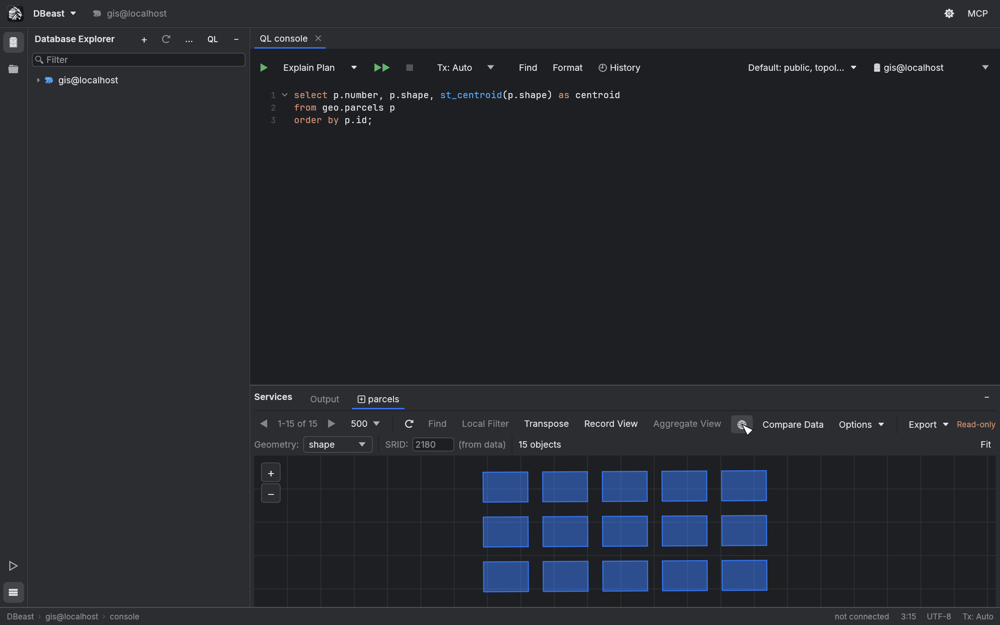
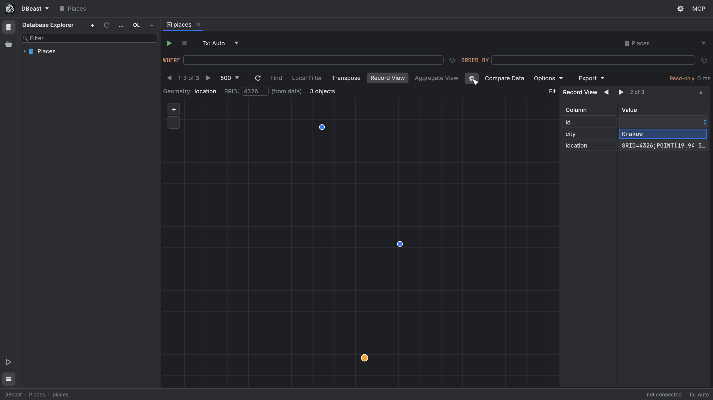
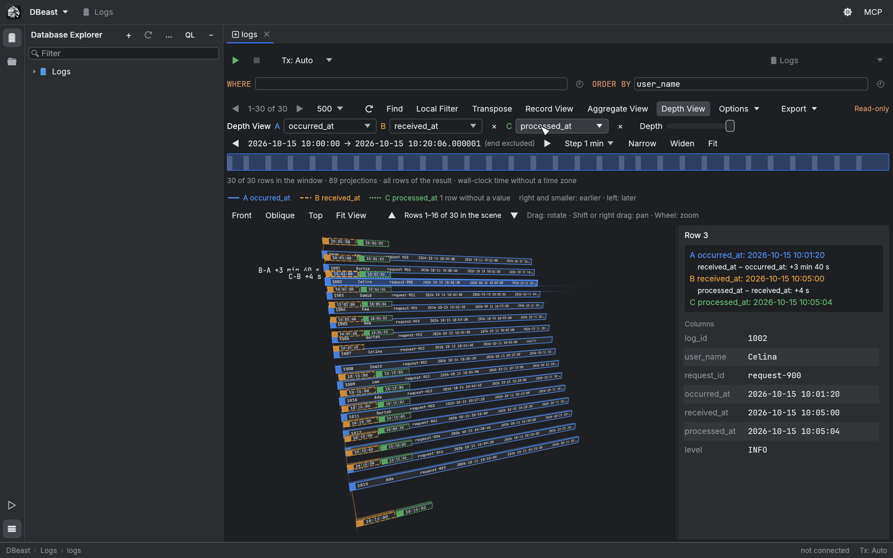
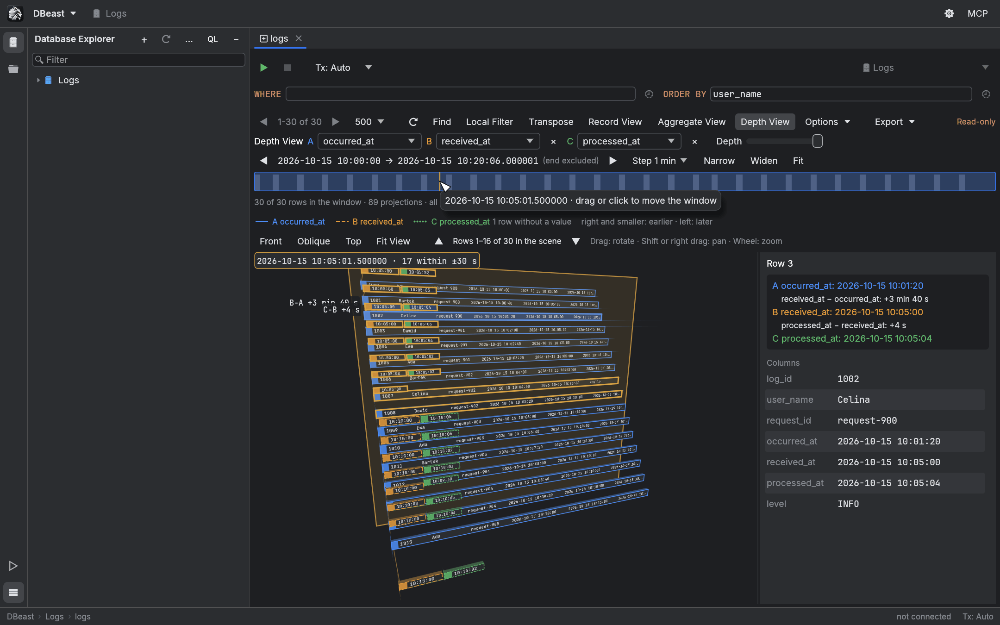
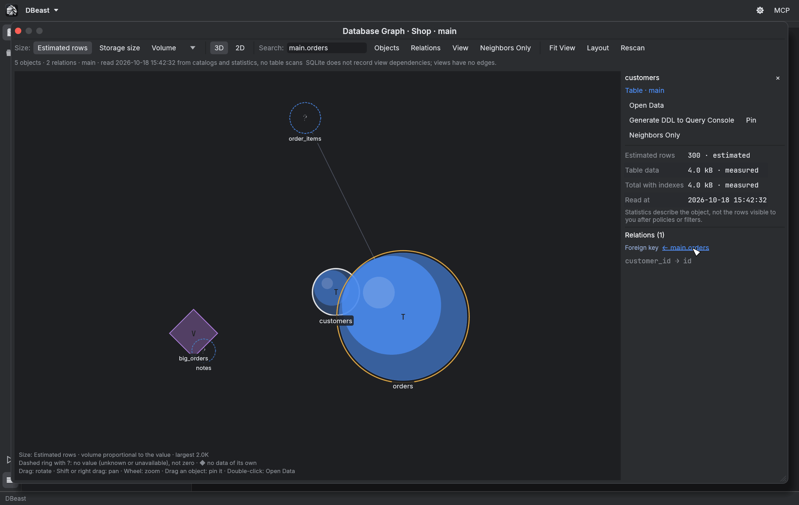
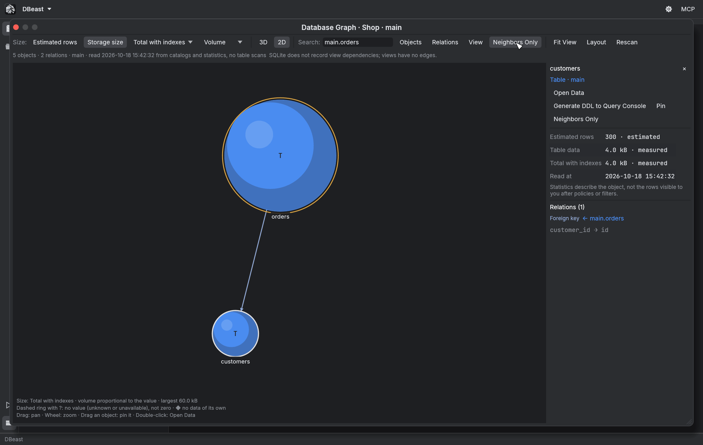

# Visualization

DBeast has three visual views: the **Geo Viewer** draws geometry columns on a map, **Depth View** lays out rows in 3D along a time axis, and the **Database Graph** shows the objects of a database and their relations in 3D or 2D. All three work on data that is already loaded or on catalog metadata, and none of them runs additional queries while you look around.

## Geo Viewer

The globe button on the results grid toolbar opens the Geo Viewer. It is active when the result contains a geometry column.

### Supported geometry formats

- WKB and EWKB from PostGIS (`geometry` and `geography`, binary or hex),
- the MySQL internal geometry format,
- GeoPackage,
- SpatiaLite,
- WKT and EWKT,
- GeoJSON.

If the result has several geometry columns, choose one in the **Geometry:** list.

### Coordinate reference systems

The SRID is taken from the data, and every EPSG coordinate system is converted to WGS84, for example PL-1992, PL-2000, UTM and Web Mercator. The **SRID:** field shows the value and its origin, such as "(from data)".

Without an SRID, coordinates within the range of degrees are treated as EPSG:4326. Otherwise DBeast asks you for the SRID. You can always type an SRID manually.

### Map

- Drag to pan, use the mouse wheel or the **+** / **-** buttons to zoom, and **Fit** to show all objects.
- Hover an object to see the record's data. Click it to select the record; the value panel and editing work as in the grid.
- The base map uses OpenStreetMap raster tiles. Tiles are downloaded with DBeast's own User-Agent, cached on disk for 7 days (in memory, only about 64 MB of recently shown tiles are kept as textures) and credited with "© OpenStreetMap contributors", following the OpenStreetMap tile usage policy. The tile server can be changed with the `tile_url` setting in the configuration file.
- Without tiles, objects are drawn on a dark background with a subtle grid.
- Large geometry columns are decoded, reprojected and triangulated in the background; the header shows "Preparing geometries…" until the objects appear, and the rest of the application stays responsive. Changing the column or the SRID cancels the previous preparation. Only objects within the visible area are drawn and hit-tested; of a large object that reaches beyond the view, only the parts near the view are drawn. The drawn map is kept while you only move the pointer, and the selected object is drawn once, on top.

**Record View** also works next to the map. The panel on the right shows the record selected on the map or in the grid, and ◀ ▶ move the selection, which is also shown on the map. Aggregate View, Find and local filters apply to the grid and are hidden while the map is shown. Local filters do not affect the map: it shows the whole fetched page.

## Depth View

The **Depth View** button on the grid toolbar appears when the result has a date or time column. It shows the fetched rows as a 3D scene in which depth is time.

### Rows and time columns

- Each row is a 3D tile with thickness. Faces turned away from the camera are skipped, and nearer tiles hide farther ones. Cell values are drawn on the tile in true perspective and clipped to the column width.
- Time column **A** places the row card. **+ Time Column** adds columns **B** and **C** as tabs above the card, each at the depth of its own time, joined by connectors. Series differ by color and outline style (solid, dashed, dotted), and the legend shows a sample line for each.
- The details panel on the right shows the times and signed differences for the selected row (for example `+3 min 40 s`). Hovering or selecting a card adds difference labels in the scene. Drag the panel's edge to widen it; long values wrap.
- Rows keep the table order, including sorting applied in the grid. The scene shows 16 consecutive rows; scroll with ▲ ▼. The selection is shared with the grid.

### Camera

- Drag to rotate, `⇧` + drag or right-drag to pan, and the mouse wheel to zoom.
- **Front**, **Oblique** and **Top** views, and **Fit View**.
- Until you move the camera, the view fits the drawn cards automatically when rows, series or the window size change.

### Time window

A histogram above the scene shows the time window.

- Drag the window, use ◀ ▶ or `←` / `→` to move it by one step (1 s, 1 min, 1 h or 1 day), and **Narrow**, **Widen** and **Fit** to resize it. The **Depth** slider controls the depth of the scene.
- A row is in the window when any of its projections falls inside it. The end of the window is excluded. A projection outside the window is marked with "…" instead of a clipped end.
- Moving the pointer over the histogram moves a translucent wall through the scene at the depth of that time, labeled with the time and the number of projections within half a step; those tiles are outlined. Tiles behind the wall are dimmed. A time outside the window is described in the tooltip and has no wall.

### Time values

- Timestamps with an offset are converted to UTC. Timestamps without a time zone are treated as local wall-clock time without conversion. Mixing both kinds in one scene is rejected with a message.
- Numbers are never guessed to be epoch times.
- Missing values are counted and reported in the status line.

Parsing, the histogram and the list of rows in the window are computed once and kept until the data, series or window changes. A wide or long page, more than 10,000 cells to parse, is read in the background while the view shows "Reading times…"; reloading or closing the result stops that work. Each frame projects only the tiles and text of 16 rows, on the CPU, without a 3D engine. Depth View works only on the fetched page and runs no queries.

## Database Graph

Choose **Show Database Graph** in the context menu of a data source, database or schema in the Database Explorer. The objects of one database open as a 3D or 2D graph.

### Nodes

Nodes are tables, partitioned tables and partitions, views, materialized views, foreign tables and foreign servers. Each kind has its own color and a letter in the node: T, P, p, V, M, F, S.

Node size shows either **Estimated rows** or **Storage size** (table data without indexes, or total with indexes). The scale is **Volume** (sphere volume proportional to the value, radius by cube root) or logarithmic, with a legend.

- Every measure has a status (measured, estimated, unknown, unavailable, not applicable), a source and a read time.
- A missing value is drawn as a dashed ring with "?", never as zero.
- Views and foreign servers, which store no data of their own, are drawn as diamonds.
- Changing the measure does not move the nodes.
- Partitions are collapsed into their parent by default, and the parent shows the sum of its partitions with a note. When expanded, the parent has no size of its own, so nothing is counted twice.

### Edges

| Edge | Meaning |
|---|---|
| Foreign key | Arrow to the referenced table; composite keys list columns in order; "Not validated" for `NOT VALID` |
| View dependency | A view reads from the object |
| Materialized view dependency | A materialized view reads from the object |
| Foreign source mapping | A foreign table belongs to a foreign server |
| Partition membership | A partition belongs to its parent |

Each kind has its own line style and a description of what it does not prove. Nothing is guessed from column names.

### Navigation and search

- Rotate, pan and zoom with the same camera as Depth View. **2D** switches to a flat layout.
- **Objects**, **Relations** and schema filters choose what is shown.
- **Search:** finds objects; Enter selects the first match.
- **Neighbors Only** shows only the selected object and its neighbors.
- Drag an object to pin it, or use **Pin** in the details panel.
- **Fit View** frames the whole graph, and **Rescan** reads the catalog again.
- The details panel shows measures, facts (for example the last `ANALYZE` or the FDW wrapper) and relations with links to the other object.

### Layout commands

The **Layout** menu contains:

- **Re-layout**, which recomputes the layout around pinned objects,
- **Save Layout**, which stores the settings and pinned objects in `session.json` (no data is stored),
- **Reset Layout**.

The **View** menu holds:

- layout forces: Link distance, Attraction, Repulsion and Schema grouping, recomputed in the background when you release the slider,
- drawing settings that apply immediately: **Spread** (moves objects apart around the center without a new layout), **Node size**, the number of labels, relation opacity, depth fading, foreign key arrows and **Turntable** (slow rotation; only then does the window repaint continuously),
- **Reset View Options** to restore the defaults.

Save Layout also stores the View settings. While the camera has not been moved, the view fits the graph, so Spread shows as larger gaps between spheres.

### Opening data

Data is read only on request: **Open Data** or a double-click opens the table, and **Generate DDL to Query Console** generates its DDL. Hovering and rotating read nothing.

### Where the data comes from

| Database | Sources |
|---|---|
| PostgreSQL | `pg_class` (`reltuples`, `relpages`); `pg_table_size` and `pg_total_relation_size` in batches of 500 relations with a 2 s `lock_timeout`; `pg_constraint` (without foreign key copies on partitions); `pg_rewrite` with `pg_depend`; `pg_inherits`; `pg_foreign_table`; `pg_foreign_server` |
| MySQL | Estimates from `information_schema.tables`, keys from `key_column_usage`, view dependencies from `view_table_usage` (MySQL 8.0.13 or later) |
| SQLite | `sqlite_stat1` after `ANALYZE`, sizes from `dbstat` for files up to 256 MB, keys from `pragma_foreign_key_list` |

- On PostgreSQL, a locked table gets the size "unavailable" with a note instead of waiting. No `ANALYZE`, `EXPLAIN`, queries to foreign servers or materialized view refreshes are run, and server options and user mappings are not read.
- On SQLite, larger files would have to be read completely, so their sizes are not measured. SQLite does not record view dependencies, so views have no edges.
- These limitations are described in the graph's status line.

### Scale and performance

- A scan covers up to 5,000 objects. A larger database is clearly marked as a partial result. Scanning runs in the background and can be cancelled.
- The force layout with schema grouping is computed in the background, deterministically, and only for the mode shown. The other mode (2D or 3D) is computed the first time you switch to it. A newer request or closing the window stops stale computations.
- At rest the window does not simulate physics. The finished picture is kept as a single mesh and redrawn only when the camera, layout, filters, selection or settings change. The object under the pointer, its relations and its name are drawn on top of that picture, so hovering does not rebuild it. Objects outside the window are not drawn; relations that cross the window are.
- Computing one layout (release build, Apple Silicon): 100 objects in 7 ms, 1,000 objects in 0.16 s, 5,000 objects and 15,000 relations in 1.2 s.
