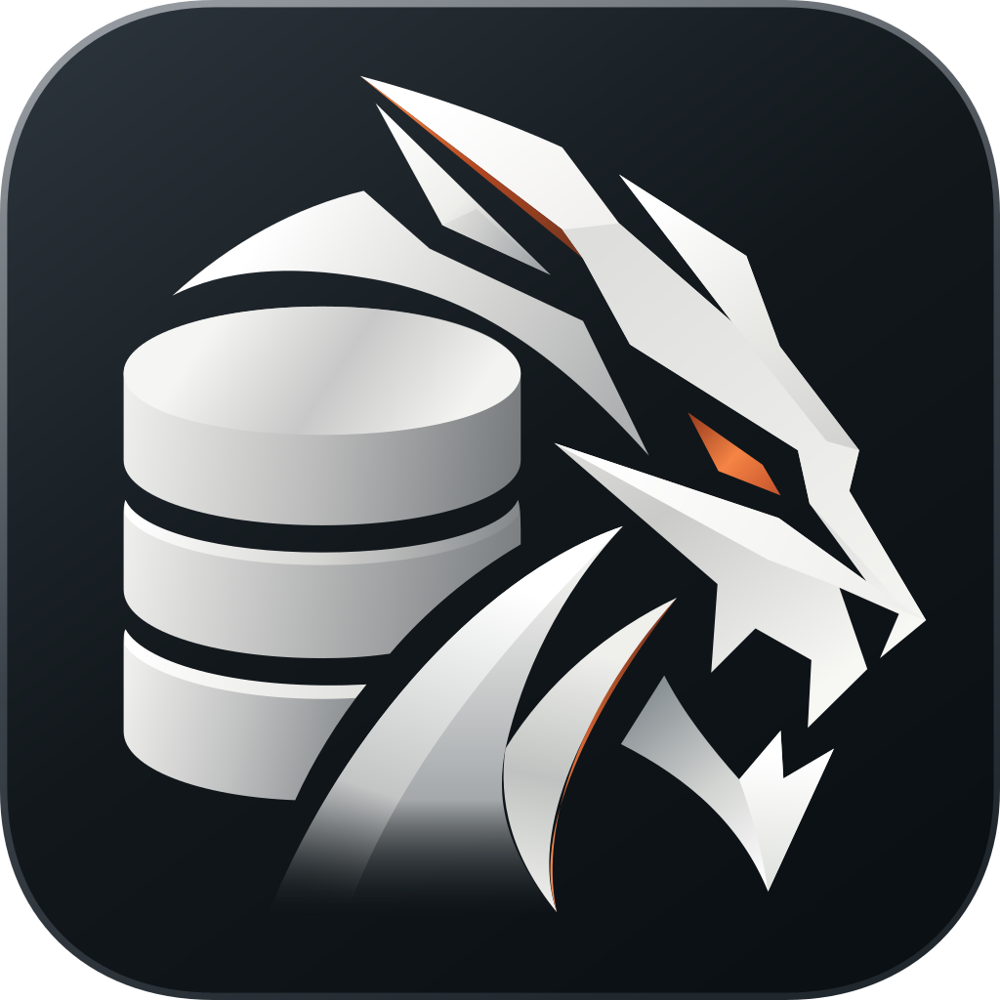
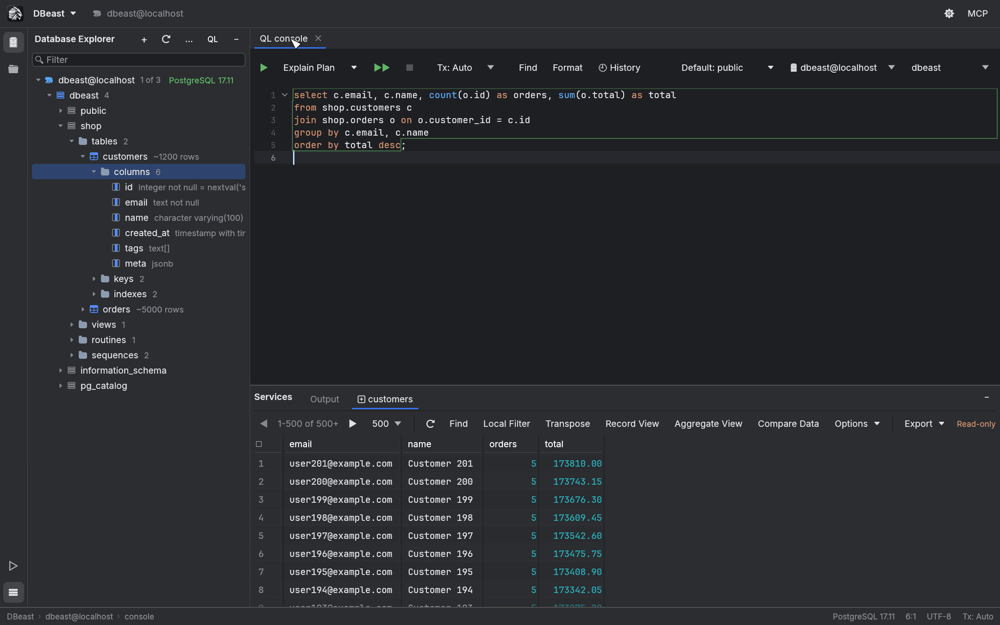

---
hide:
  - navigation
---

# DBeast

A fast, native database client for PostgreSQL, MySQL and SQLite, written in Rust.

[Get started](guide/getting-started.md){ .md-button .md-button--primary }
[View on GitHub](https://github.com/macolszewski/dbeast_manager){ .md-button }

DBeast is a desktop database IDE that starts instantly, stays light on memory and keeps large
result sets smooth. It brings the tools of a professional database environment, a SQL
console, an editable result grid, query plans, data transfer and a schema graph, into a native
application with no virtual machine underneath. A built-in MCP server lets AI agents work
with the databases you choose to share, under your control.

## What you can do

- **Write and run SQL**

    ---

    Consoles with completion, folding, formatting, history and transactions.

    [:octicons-arrow-right-24: SQL console](guide/sql-console.md)

- **Browse and edit data**

    ---

    A virtualized grid with Record View, local filters, aggregates and batch editing.

    [:octicons-arrow-right-24: Results grid](guide/results-grid.md)

- **Understand the schema**

    ---

    Database Explorer, DDL, DDL Diff, query plans and the Database Graph.

    [:octicons-arrow-right-24: Database Explorer](guide/explorer.md)

- **Move data**

    ---

    Export and import files, and run pg_dump, pg_restore and psql in the background.

    [:octicons-arrow-right-24: Import and export](guide/import-export.md)

- **Watch the server**

    ---

    A live PostgreSQL Activity Monitor with blocking chains and session control.

    [:octicons-arrow-right-24: Activity Monitor](guide/activity-monitor.md)

- **Work with AI agents**

    ---

    A local MCP server with sharing levels, exact-SQL approval and enforced read-only access.

    [:octicons-arrow-right-24: AI agents](guide/ai-agents.md)

## Built for speed

| Metric (Apple Silicon, empty configuration) | Result |
|---|---|
| First frame, warm start | 75-125 ms |
| Resident memory, idle | about 100-107 MB |
| CPU, idle window | 0% |

The UI thread only draws. Database, network and disk work runs in the background, and
the grid and the explorer render only what is visible. See [Performance](reference/performance.md)
for the methodology and per-feature measurements.

## Platforms and databases

- **macOS** with an integrated title bar and Metal rendering.
- **Linux** and **Windows** with OpenGL rendering and the system title bar.
- **PostgreSQL**, **MySQL** and **SQLite** through native Rust drivers, plus CSV, TSV,
  Data Package and SQLite files opened as temporary sources.

DBeast is open source under the Apache License 2.0, created by
[Maciej Olszewski](https://github.com/macolszewski).
